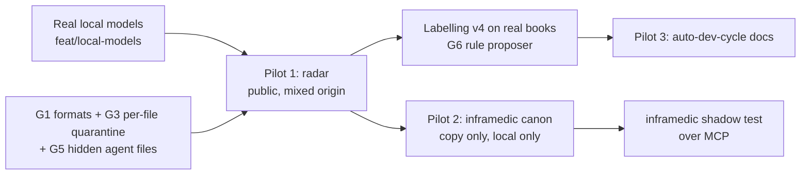

# Real use — candidate projects, gaps and labelling

**Status:** PLAN 0.1, 2026-10-22 (D61). It is for the operator's decision (§6).
**Basis:** three read-only investigations of 2026-10-22. The full reports are only on this machine, in the git-ignored `research/2026-10-22-repos/`. They describe private repos, so they are not in this public repo.
**Language:** ASD-STE100 Simplified Technical English.

## 1. Result

1. **onprem-ai-adoption-radar (public, MIT):** the best case for **mixed origin**. In one repo there are:
   - 2,533 news summaries that Claude wrote; each record names the model;
   - 1,073 Jev labels;
   - deterministic briefs with receipts;
   - Claude-authored reports that the owner approved;
   - docs with Co-Authored-By trailers.

   It is public, so it can also be our **public test set** (labelling v4 §4).
2. **inframedic (private):** its **Knowledge Center** has the same ideas as Kütüphane: content-addressed versions, authorize-first retrieval, audit and signed exports. It has no rights, origin, `ai_use` or valid-time fields, no reranker and no import side. Kütüphane can take over the **shared canon** and the **offline export/import**. inframedic keeps session uploads, redaction, device facts and runbook execution. The seam is MCP. A copy-only pilot does not block inframedic development.
3. **Other repos:** the survey covered 58 repos. Three repos add the most coverage:
   - **Polemik publishing:** third-party copyright, an outside holder, `ai_input: n`, scanned PDFs;
   - **auto-dev-cycle:** model origin at scale, review supersession (acceptance), decisions (mandate);
   - **SIMS + MDF-site:** real agent skills (`activate`), third-party skill licenses, student personal data.
4. **Kütüphane has real gaps** that the tests did not show (§3). The most important: many text formats are stored but not searched; one bad file refuses the whole book; hidden folders such as `.claude/` are skipped; `kstd-init` proposes no origin.
5. **Labelling is necessary, but most origin labels can be derived** from model fields, trailers, paths, front matter and PDF metadata. A person must label mainly these:
   - `assisted` against `model`, which is a question about a real review;
   - personal data in fixtures and documents;
   - `ai_use` for third-party content;
   - mandate.

## 2. Candidates and what each one tests

| Project | Visibility, license | Proposed books | Fields it tests best | Items to label by hand |
|---|---|---|---|---|
| **onprem-ai-adoption-radar** | public, MIT (the data has no separate license) | `radar-docs` (about 90 md), `radar-news-classified` (JSONL), `radar-briefs`, `radar-config` | origin (per record), third-party rights, valid time | about 130 docs + a sample of 200 records |
| **inframedic** | private, no license file | `inframedic-canon` (13 platform canon files + the 20 `ships: true` docs), later `inframedic-doctrine`, `-sources`, `-fixtures` | origin (65 % of commits have trailers), personal data (IPs, e-mail in fixtures), handling, mandate (`corpus-canon.txt`), structured applicability (platform) | about 77 (core) or about 240 (full) |
| **Polemik publishing** (`dizgi-otomasyonu`, `indesign-tools`, sites) | private, none stated; works of outside authors | `polemik-manuscripts`, `polemik-ops-docs` | license `unknown`, an outside holder, `ai_input: n`, OCR | about 110 |
| **auto-dev-cycle** | Apache-2.0 | `adc-design`, `adc-reviews` (398 model reviews), `adc-spec` | origin at scale, acceptance (review rounds), mandate (decisions D1–D63), tool output | about 80 (sample) |
| **SIMS + MDF-site (+ CTIS docs)** | private; some skills Apache-2.0 per item | `sims-agent-skills`, `mdf-skills`, `ctis-team-docs` | `activate`, per-item third-party license, student personal data + legal basis | about 270 |
| alternate: **kosgeb** | private | `kosgeb-grants` | valid time (program deadlines), `applies_to` (region, company type) | about 40 |

**Leave out for now:**
- `homelab` and `bukaportal-nextcloud`, because they contain files with credential-related names and an LDAP snapshot;
- `HalluxValgus`/`Ayak`, because they contain medical images;
- the code-only repos.

## 3. What Kütüphane lacks (found by the investigations)

| # | Gap | Found in | Effect today | Size |
|---|---|---|---|---|
| G1 | `.txt`, `.json`, `.jsonl`, `.yaml`, `.sh`, `.ts`, `.html`, `.xml` are stored but **not searched** (`profiles.py`) | all | radar data, inframedic sources, kosgeb records and homelab runbooks are invisible to search | small–medium |
| G2 | **JSONL record chunking**: one record = one passage, with per-record provenance (`model`, `classified_at`, `citation`) | radar | a 1.4 MB file becomes one document; per-record origin is lost | medium |
| G3 | **One bad file refuses the whole book** (for example a PDF with no text layer). There is no per-file quarantine. | Polemik | the book cannot be published | small |
| G4 | **No OCR** | Polemik | scanned books cannot be searched | medium (local OCR model) |
| G5 | **Hidden folders are skipped** (`.claude/`), and instruction detection misses agent files (agents, commands, rules, learned skills) | SIMS, MDF | agent instructions reach agents with only `read`, not `activate`. **This is a safety gap.** | small |
| G6 | `kstd-init` **proposes no labels**. It could read git trailers, paths, front matter, PDF metadata and record fields. | all | every file starts as `unknown` | medium; this is the labelling v4 rule proposer |
| G7 | **No origin value for deterministic tool output** (typedoc, schemadoc, templated briefs) | radar, LLMDAP, auto-dev-cycle | it must be labelled `human` or `model`, and both are wrong | decision (§6) |
| G8 | `applies_to` is **free text with no search filter** (platform, version, region) | inframedic, kosgeb | an agent cannot ask "only Proxmox 8" | medium |
| G9 | **No write API and no incremental republish.** Ingest is CLI only. | radar (bots commit every 2 h), inframedic (knowledge made at run time) | a full republish for each change | medium |
| G10 | Access per item and per device; redaction before indexing; per-payload encryption | inframedic | inframedic keeps these; not needed for the pilot | large; later |
| G11 | Duplicate detection across books, and links between translations | Polemik (the same PDF in 3 repos), LLMDAP (TR/EN pages) | duplicate hits | small; later |

**Model routes:** the LLMDAP routes `chat`, `emb` and `rerank` still point to the stub models. A separate branch, `feat/local-models`, wires these real local models:
- bge-m3 for embeddings;
- bge-reranker-v2-m3 for reranking;
- Qwen3.8-27B on the existing vLLM for chat.

Real use needs this first.

## 4. Proposed order

1. **Prerequisites:** the real local models, then G1, G3 and G5. They are small and every pilot needs them.
2. **Pilot 1, radar.** It is public, so no private content is at risk. Books: `radar-docs` and `radar-news-classified` (needs G2). Use cases:
   - "Which serving engines support NVFP4 on Blackwell, and what do they cite?"
   - "Why were rings replaced with Pulse?"
   - Agent task: "Summarize the vLLM security news; cite only Claude records that pass the schema."
3. **Labelling v4 runs on these real books**, not only on the old labelling corpus:
   - the G6 rule proposer suggests origin and dates;
   - Qwen suggests the rest;
   - the operator confirms by folder and corrects the exceptions.

   The radar owner gave up an up-front gold set ("impossible to label"). So we label **while we use the library**, in small batches, and not as one large upfront task.
4. **Pilot 2, inframedic canon.** Work on a **copy** (`kstd-init` writes into the folder). Use the 13 canon files and the 20 `ships: true` docs. Run local only. Ask the 6 use-case questions in the local inframedic report (§5). Then do a shadow comparison with inframedic's own retrieval, over MCP.
5. **Pilot 3, auto-dev-cycle docs.** Then Polemik (rights and OCR) and SIMS (`activate`), when G4 and G5 are done.

## 5. Risks

- **The name "Kobra":** inside inframedic it is the sandbox agent, not this repo. Keep the names apart in books and prompts.
- **Private data in books:**
  - inframedic fixtures contain IPs and an e-mail address;
  - the CTIS documents contain student IDs;
  - homelab has files with credential-related names.

  Run these books **local only**. Run the secret and personal-data scan before ingest.
- **False `assisted` labels:** a merge is not a review in substance. Without a real review the label is `model` (Art. 50(4)).
- **Third-party books (Polemik):** never send them to a model without the publisher's consent (`ai_input: n`).
- **Two sources of truth during the inframedic shadow phase:** the inframedic catalog stays the authority until a person cuts over.

## 6. Decisions for the operator

1. **Order:** agree with §4, or choose another first pilot?
2. **Tool output (G7):** add an origin value `tool` for deterministic generator output, with no AI marking? Or count it as `human` (a person wrote the generator)?
3. **Labelling v4 target:** label the real pilot books (radar first) instead of the old labelling corpus?
4. **Polemik:** may the publisher's own books go into Kütüphane, with `ai_input: n` (search only, never to a model)?
