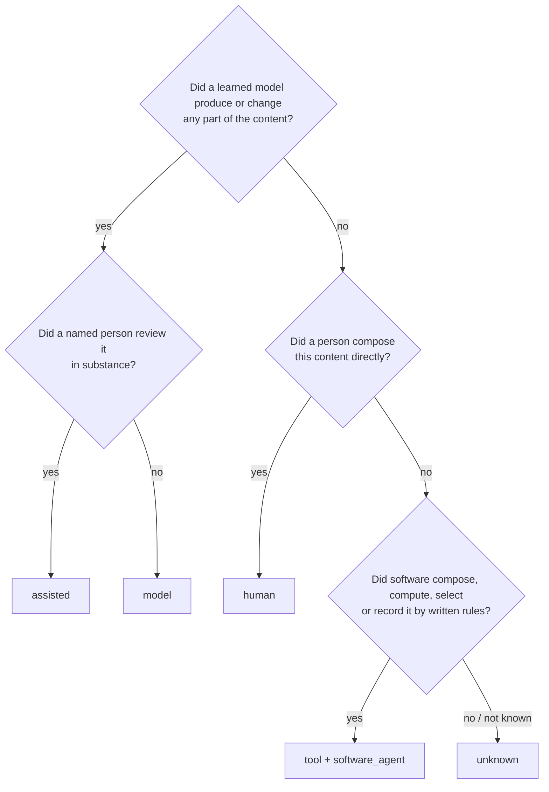

# Origin of program output — options and the exact boundary

**Status:** PROPOSAL 0.2, 2026-10-23. It replaces `docs/16` §1, and it is for the operator's decision (§7).
**Basis:**
- the operator's direction of 2026-10-23: one category is enough, unless a split changes a behavior; the new category must exclude generative AI by definition; categories must have exact definitions;
- the research in `docs/research/2026-10-22-tool-origin.md`.

**Language:** ASD-STE100 Simplified Technical English.

## 1. What origin is for in kstd

kstd does not classify content as "AI or not" for its own sake. The origin value controls only these behaviors:

| Behavior | Rule today |
|---|---|
| **Marking on export** | `model` and `unknown` are listed as `ai_generated`; `assisted` is listed with its reviewer (EU AI Act Art. 50(4)) |
| **Notice on delivery** | the origin is shown with each passage |
| **Authority** | origin gives no authority. Authority comes only from acceptance and mandate. But a reviewer must know what they accept. |
| **Fail closed** | `unknown` counts as `model` |

A new value is justified only if it changes one of these behaviors, or adds a behavior that a real system needs (D53). inframedic needs such a behavior. It must trust or suspend everything that one generator version made, and it must regenerate output when its inputs change.

## 2. The boundary: written rules vs learned parameters

The test is **not** "is the output repeatable". A language model at temperature 0 is repeatable, and the Disclosure CG says that repeatable output alone does not exclude generative AI. The test is **where the behavior of the producer comes from**:

| Term | Exact definition in kstd |
|---|---|
| **learned model** | Software whose behavior comes from parameters fitted to data by training. This includes generative models (LLMs, image models, machine translation, modern OCR and speech recognition) and non-generative models (classifiers, embedding models, rerankers). |
| **generative AI** | A learned model that produces content: text, code, images, audio, or structured data that a person can read. |
| **written rules** | Code, templates, queries, configuration or rule sets that people wrote. Every output can be traced to a line of these rules and to the inputs. |
| **recording** | A device or program that stores events or measurements of the world as they occur (logs, captures, sensor readings, monitoring snapshots). |

**Note:** "written rules" is wider than the EU AI Act's idea of "not an AI system". The Commission guidelines count logic- and knowledge-based inference engines as an AI technique. In kstd, a rule engine with rules that people wrote (for example inframedic's threshold diagnosis) is **not** a learned model, so its output can be `tool`. kstd records how content was made. It does not decide the legal status of a system.

## 3. Options

| | **A. No new value** | **B. One value `tool`** (recommended) | **C. Two values `programmatic` + `observed`** | **D. Two axes** |
|---|---|---|---|---|
| What it is | program output is labelled `human`, as the Disclosure CG suggests | one value, defined in §4; the difference between a transform and a recording comes from fields that already exist (`inputs`, observation time) | the previous proposal (`docs/16` §1) | split origin into "generative AI involvement" (none / reviewed / not reviewed / unknown) × "producer" (person / software) |
| Change to kstd | none | +1 value, +1 field (`software_agent`) | +2 values, +2 fields | the origin field is replaced; every label migrates |
| inframedic needs | **not met**: no generator version, so no trust or suspension per version | met | met | met |
| False claim risk | a log says "a person wrote this" | none | none | none |
| Disjoint-category problem | — | one extra category; mixed content still needs `needs_split` | two extra categories | the categories combine, so they are not disjoint |
| Cost | none | small | medium | large |

**Why B and not C:** every behavior that C gave to `observed` can be read from fields that already exist:
- an item with `software_agent` and **no** `inputs` is a recording, and it needs an observation time (docs/11 §5 Applicability already has one);
- an item with `inputs` is a transform, and it is regenerated when an input changes.

So the split adds no behavior that B lacks (D53).

**Why not D now:** D is the cleanest model for mixed content. But it changes a field that is already in use. The labelling v4 data will show whether mixed content is common: the `needs_split` rate and research question Q5. **Decide D after the first labelling batches, with data.**

## 4. Option B: the exact definition of `tool`

> **`tool`**: Software produced the content by running written rules (§2) on recorded inputs, or by recording events of the world. **No learned model produced or changed any part of the content, at any step of its production.** A person wrote the rules, not the content.

**Required:** `software_agent: {name, version}`. Without it, the item counts as `unknown`, so it is marked as AI on export. This fails closed.

**Optional:**
- `inputs`: present for a transform;
- an observation time: required for a recording (an item with no inputs).

**The decision order for any item.** The first "yes" decides.

**The form-only rule:** a program that changes only the form of content keeps the origin of its input. Examples: a format conversion, text extraction from a PDF text layer, minification, a formatter, a dictionary spell-check. The content was composed in the input, not by the program. IPTC calls this `algorithmicallyEnhanced`, and it is recorded as an action, not as an origin.

**The input rule:** if a `tool` item records its inputs, every input must be `human` or `tool`, at every step of the lineage. One `model` or `unknown` input makes the output `model`. One `assisted` input makes it `assisted`, with that input's reviewer.

## 5. Behaviors of `tool`

| Behavior | `tool` |
|---|---|
| Marking on export | **never** AI-marked. Disclosure CG: `human-only`, which is the report's own guidance for content with no generative AI. IPTC: `dataDrivenMedia` for a transform, `digitalCapture` / `screenCapture` for a recording. C2PA: `softwareAgent`. |
| Notice on delivery | "made by `<software_agent name> <version>`" |
| Trust and suspension | acceptance can be delegated to a named generator and version. A faulty version suspends **every** item that it made, and nothing else. |
| Change | a transform with recorded inputs goes to `pending` when an input or the generator version changes, until it is regenerated. A recording cannot change; an edited recording is a new `tool` transform whose input is the recording. |
| Erasure | transform: erase the input and regenerate. Recording: delete or redact. A redacted copy is a transform. |
| Personal data | no special rule. The default `unknown` (= `yes`) applies, and that is correct for logs. |
| Mixed content | a document that has rule-made parts and model-written parts is `model` and gets `needs_split`. |

## 6. Test cases (the expected origin, from §4)

| # | Item | Origin | Why |
|---|---|---|---|
| 1 | typedoc page from TypeScript that a person wrote | `tool` | software composed it from human inputs |
| 2 | typedoc page whose doc comments an LLM wrote | `model` | input rule |
| 3 | nginx access log | `tool` (recording) | no inputs, so an observation time is required |
| 4 | the same log after a fixed IP-masking script | `tool` (transform, input = item 3) | written rules only |
| 5 | inframedic: metrics snapshot → threshold rules → LLM narrative | `tool` → `tool` → `model` | only the narrative is AI-marked |
| 6 | weekly report from a template and database numbers | `tool` | — |
| 7 | the same report with one LLM-written paragraph | `model` + `needs_split` | a learned model changed part of the content |
| 8 | a template that an LLM fills in; no review / a named substantive review | `model` / `assisted` | approval of a pipeline is not a review |
| 9 | Prettier-formatted markdown that a person wrote | `human` | form-only rule |
| 10 | code generated from a protobuf schema | `tool` | written rules |
| 11 | OCR text of a scanned letter that a person wrote (neural OCR) | `model`, input = the scan (`human`) | a learned model produced the text; OCR errors are possible |
| 12 | classifier labels (Jev, Laya) | `model` | a learned model; it is not generative, but it is not written rules (§7.2) |
| 13 | an embedding vector | `model` | a learned model |
| 14 | `origin: tool` with no `software_agent` | counts as `unknown` | fails closed |

## 7. Decisions for the operator

1. **Option B:** one value `tool`, with the definition in §4 and the behaviors in §5? Decide option D after the first labelling batches.
2. **Learned but not generative** (classifiers, embeddings, neural OCR, speech recognition): count them as `model`, not as `tool` (recommended; fails closed)? The other choice is a sub-value of `model` for non-generative output, which changes only the export marking.
3. **Rule engines:** may the output of a rule engine with rules that people wrote be `tool`, even though the EU AI Act can count such an engine as an AI technique (§2 note)?
