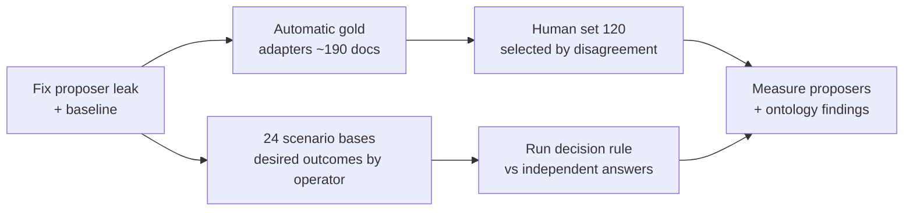

# Labelling v5 — curation first

**Status:** PLAN 1.0, 2026-10-26. Accepted as D67; §7 records the answers.
**Basis:**
- the operator, 2026-10-26: the v4 labelling is "meaningless"; the radar queue asks to label single `labels.jsonl` records whose answers are known;
- Astra's review: `docs/research/2026-10-26-astra-curation-raw.md`;
- the real-source survey: `docs/research/2026-10-26-real-gold-sources.md`.

It replaces the labelling queue of `docs/16` §2. The v4 items stay on disk.

**Language:** ASD-STE100 Simplified Technical English.

## 1. What went wrong

1. **Known answers were asked again.** Many radar items carry their answer in their own data: a record names its model, or a template made a file. A person adds nothing there.
2. **The unit was wrong.** A single JSONL record or a config file is not what a library user meets. The page also sorted by family, so 20 nearly identical records came first.
3. **The hard facts were not tested.** The fields that change decisions are exactly the ones a person cannot read from the text: status and supersession, validity, a named approver, the licence of each file, real vs synthetic personal data, lineage and trust. The human labels tested almost nothing of the ontology.
4. **There was no selection for value:** no disagreement sampling, and no stratification by the decision outcome.
5. **The measurement leaked** (Astra P0): `propose.py` could take the source's `known.acceptance` as its prediction, and the same field is the gold answer.

## 2. Principles (Astra review, accepted as the plan)

1. **Three sets with three different targets, scored separately:**

   | Set | Measures | Who gives the answer |
   |---|---|---|
   | **Automatic gold** | Can the proposers and adapters extract what the *source declares*? | the source's own metadata, through a checked adapter |
   | **Scenarios** | Does the decision rule give the right result for a full case (files + statements + trust + one request)? | two people, independently, from the written spec. Never the engine. |
   | **Human set** | Can a person (and a proposer) judge what only a person can judge? | the operator, and a second reviewer for a sample |

2. **A source declaration is not a local decision.** A PEP that says `Status: Final` is gold for "the source declares it accepted". Accepting it **locally** still needs a policy and an authorized issuer. A signature proves who signed, not that the content is true.
3. **The unit is one meaningful case:** a whole document, a skill package, a replacement chain, or a record together with its provenance. File digests and rights stay underneath.
4. **Every case must answer a research question** (Q1–Q27 in `docs/research/2026-10-22-labelset-public.md` §4). It names the operation, the evidence, the fact under test, and the expected result or reason. Coverage: index, model input, export, activation, authority, supersession, trust, erasure, and also successful uses, not only denials.
5. **Keep the semantics of the source:**
   - `Updates` ≠ `Obsoletes` ≠ retraction ≠ supersession;
   - a publication date is not a validity date;
   - an assigned reviewer is not a completed review;
   - a citation is not complete lineage.

## 3. Composition: about 380 cases

### 3.1 Automatic gold (about 190 documents, no human labelling)

| Source | Docs | Fields the source declares | Licence | Trap to handle |
|---|---|---|---|---|
| Python PEPs | 40 | status, `Superseded-By`/`Replaces`, `Resolution` (date + link), delegate as approver, release validity (`release-cycle.json`) | CC0-1.0 or public domain (→ `LicenseRef`) | a Final PEP with `Superseded-By` is a successor in another scope, not a withdrawal; take the text at the Resolution-date commit |
| IETF RFCs | 30 | `obsoletes`/`obsoleted_by`/`updates`, status, date; IESG ballot names | IETF TLP (not SPDX) | partial obsoletes; `updates` is not a supersession |
| Kubernetes KEPs | 25 | status (implemented, withdrawn, replaced), milestones; approver **only** from the PRR file | Apache-2.0 | the listed reviewers and approvers are assigned, not proof of approval |
| ADRs (mozilla/fxa MADR) | 20 | `Status: superseded by`, `Deciders` | MPL-2.0 | adr-tools writes "Accepted" by script, so those are not gold |
| REUSE / SPDX repos (reuse-tool, curl, Linux docs) | 30 | the licence of each file; folder defaults from `REUSE.toml` | per file | files with no header → `unknown` |
| Assisted docs (dotnet/docs, sentry-docs) | 25 | added doc + model co-author + an **APPROVED review by a named human** of the last model commit → `assisted` + `reviewed_by` | CC-BY-4.0 / FSL | an approval covers the diff; `ai-usage` is a claim by the model itself; 5 negatives (no approval, or a bot reviewer only) |
| Nanopub chains | 15 | signer key, supersession, retraction (also by another key → a contest mark), licence | per nanopub | batch supersessions by script |
| TAB court cases (whole documents) | 10 | real personal data (spans, direct identifiers) | MIT (annotations) | no legal basis inside |
| Radar (whole derivation bundles, not single records) | 5 | brief → its news inputs → their model | MIT | G24/G25: not `tool` gold until the generator version is recorded |

**Deferred:** Rust RFCs (unclear licences of old RFCs), W3C TR (approval only by the body), C2PA (image fixtures only), Croissant/HF cards (free text, made by a tool).

### 3.2 Scenarios (72 requests = 24 base cases × 3 variants)

- **Each base case** is a small folder with:
  - the files;
  - the signed statements;
  - the policy;
  - the trust configuration;
  - the evaluation time;
  - **one request** (operation + actor).

  Its expected result includes the notices and the state after the request, not only permit, deny or escalate.
- **Variants:**
  - a baseline;
  - one consequential change (the result must change);
  - one irrelevant change, for example a file renamed (the result must **not** change).
- **Topics:**
  - a restricted input two steps up the lineage, and a missing ancestor;
  - a cycle;
  - a partial supersession;
  - an expired delegation, and key rotation;
  - an untrusted loosening vs an untrusted withdrawal;
  - a stale status (authority only, vs a suspension policy);
  - a synthetic-person claim from a trusted vs an untrusted issuer;
  - a quoted attack vs an executable instruction;
  - an access-tag change (D65);
  - an incomplete erasure.
- **Expected answers:**
  - the operator (or the domain owner) first writes the *desired* outcome and the reason, without seeing the engine;
  - a second person derives the result from `docs/11`;
  - a disagreement becomes a specification issue, not a forced label;
  - the engine is never used to write expected answers.
- Held-out cases stay sealed until the rule is frozen.

### 3.3 Human set (120 whole cases)

These are the judgments that only a person can make:

| Group | Cases | The person judges |
|---|---|---|
| Review evidence | 30 | Did a named person review this model text in substance, or only approve or merge it? (PRs + diffs + review comments) |
| Instruction safety | 30 | Is this skill or agent file harmful, risky or safe? (whole skill packages; hostile/clean twins; benign security texts) |
| Normative meaning | 30 | Is this a binding rule, advice or history? What is its scope? (policies, procedures, ADRs, runbooks with context) |
| Personal data | 30 | Does it identify a real person? Is "synthetic" believable? (TAB, Gretel, Wikipedia living people, ambiguous cases) |

- **Selection in each group:** 5 calibration + 15 where the proposers disagree or are unsure + 10 chosen at random. The selection and the proposer versions are frozen.
- **The 40 random cases + 20 difficult cases** get a second, independent reviewer. Disagreements are resolved together.
- **This is a diagnostic pilot.** 120 cases cannot prove a near-zero rate of dangerous errors.

## 4. The labelling page, changed

1. **Fixed, mixed batches of 10,** with at most 2 cases from one source family. No more 20 records of one kind.
2. **Each case shows:**
   - the **operation** it is about;
   - the whole document or package;
   - the relevant provenance (PR reviews, status lines);
   - **why it was selected.**
3. **Only the open question of that group** is asked, plus "insufficient evidence" and an evidence pointer.
4. **Activation becomes an "activation-risk" annotation.** It is not an authorization.
5. **Suggestions:** see question 3 in §7. Astra recommends judging first and seeing the suggestions after.

## 5. Fixes before any new labels

- `propose.py` must not read answer-bearing source fields (`known.*`) as evidence. Raw evidence, reference answers and policy inputs are kept apart.
- Both proposers get the same evidence and are scored on the same items, against a **metadata-only baseline**.
- `stale_after` is a freshness deadline, not `valid_to`.
- The ontology question about stale status: by default, a stale imported status removes **authority only**. A suspension needs an explicit policy (docs/11 §4 rule 6 vs §6). See question 5 in §7.

**Done in `experiments/labeling_v5/`:**
- `propose.py` (`rules-v5.2`) reads one whole case through `view()`: the file bytes, the paths, the declared licences and `case.json` `evidence`. It never reads `statements`, `why_selected`, the group, `copy`, `local_path` or any gold file. In the auto set the declared licence is an answer under test, so `view()` drops it there; with no bytes the proposer makes no licence claim. `--baseline` (`baseline-v5.2`) is the same rules without the file bytes. `stale_after` is proposed as its own field, never as `valid_to`.
- `llm_propose.py` (`llm-v5.2`) gets the same `view()` through the local LLMDAP `chat` route.
- **Version 5.2 (D68):** a source status "Rejected" gives the acceptance `rejected` (never accepted), not `withdrawn`. The Qwen prompt has `rejected` as an acceptance choice, with its definition. Only the auto set was proposed again; the human proposals stay frozen (`rules-v5.0`, `llm-v5.0`, `baseline-v5.1`).
- `eval_auto.py` scores the three proposers on the auto set: accuracy, abstention, wrong answers and the dangerous errors. The results are in `docs/21-labelling-v5-auto-results.md`.
- `test_propose.py`: a case with no status line in its evidence gets no acceptance proposal, even when its statements and gold say `accepted`. In the auto set, a missing copy or a declared licence gives no licence proposal. A "Rejected" status gives `rejected`. `test_llm_propose.py` and `test_eval_auto.py` test the Qwen schema and the scorer.
- The human set was selected with `rules-v5.0` and `llm-v5.0`. Version 5.1 changes only the auto set and the no-bytes licence claim.
- `select_human.py` picks the human set (seed 20261026; 5 calibration + 15 disagreement/uncertainty + 10 random per group; at most 2 cases per family) and freezes it in `human/pool.selection.json`.
- The outputs are in `research/labelling-v5/`: `proposals.<set>.jsonl`, `proposals_baseline.<set>.jsonl` and `proposals_llm.<set>.jsonl`, with `proposer_version` on each line.

## 6. Order of work

The old v4 queue is closed. Any labels that are already saved are kept as history.

## 7. Operator answers (D67, 2026-10-26)

1. Replace the queue: **yes.**
2. First operations: **search and model answers.**
3. Suggestions: **judge first, then see the suggestions.**
4. Second reviewer: **Astra** (human-human agreement is not measured; the limit is reported).
5. Stale status: **removes rule authority only.**
6. Redistribution: **references + hashes + our labels only** for unclear rights.

### The questions as asked

1. **Replace the queue:** may we close the 1,063-item v4 queue and use this plan (about 190 automatic, 72 scenarios, 120 human)?
2. **First operations:** which two operations matter most first: search, model answers, export, agent activation, or "is this the current rule"?
3. **Suggestions in the human set:** do you judge first and then see the suggestions (a fair measurement, two clicks), or are the suggestions preselected (faster, but your choice can drift toward them)?
4. **Second reviewer:** who checks a sample of your labels? A colleague, or nobody for now?
5. **Stale status:** by default, does a stale imported status remove only rule authority (the item stays usable as evidence)?
6. **Redistribution:** for cases with unclear rights, may the public benchmark contain only references, hashes and our annotations, and no content?
