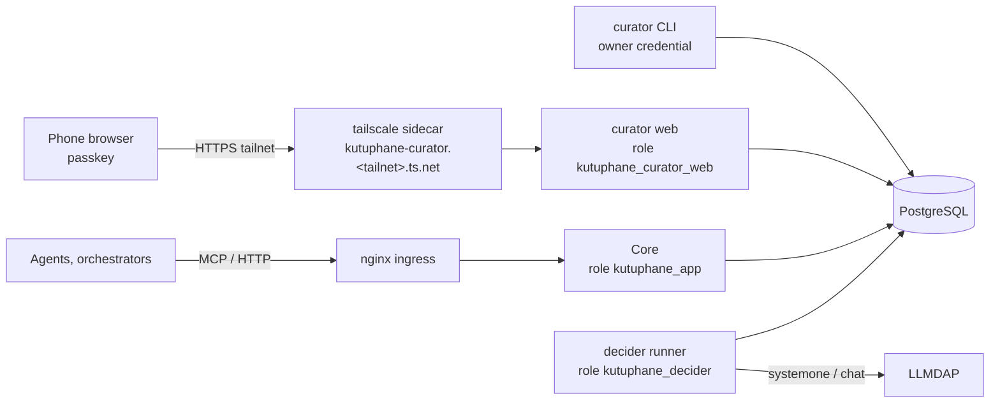

# Curator queue, passkey acts, "my words" confirmation and delegated curate — design

**Status:** DESIGN 0.3, 2026-10-27. Branch `docs/curator-design`. 0.2 applies the 21 findings of Astra's review (§15); 0.3 records the defaults adopted for the open questions (§14). No code changes.
**Language:** ASD-STE100 Simplified Technical English.
**DDL check:** the SQL of §4 applies on top of the migrations of `main` at `c9fa3eb` (001–022 and 027: 021 and 022 are SkillScan, D71; 027 is the note import, #75; PostgreSQL 17, pgvector 0.8). The curator work has migrations 023–026; this design uses 023–025. 71 probes on a scratch database (three test roles, the role grants of §4.5) show that the keys, triggers and row-level security refuse the forbidden rows and accept the allowed ones (§12.1).
**Basis:** issues #77, #78; D70, D72, D73 (`docs/01`); `docs/22` §4 (R1–R7); `docs/research/2026-10-27-human-vs-agent-origin.md`; `docs/24` (§5.3, §8, §11, §12, §20, §21, §22); `docs/20` (D67) and D43/D44 (judge first, blind model); D56 (an automatic approval needs a signed, scoped, time-boxed delegation; the approver is never the author); the code at `355b1c7`; `py_webauthn` 3.0.1; `mcp` 2.3.0 (`InputRequiredResult`, URL-mode elicitation).

**Rule for this document (D53):** each field and each value has a "changes" note. If a field changes no behavior, it is not in this design.

## 1. Summary of the decisions

| # | Decision | Section |
|---|---|---|
| 1 | A new, separate process, **curator web**, serves the phone page. It has its own origin, its own database role and no MCP. Core (MCP and HTTP) still has **no** Standing path. | §3 |
| 2 | **Curator web is in the trusted base**, as the CLI host is (docs/24 §8.2). The guarantees of this design hold against agents, Core, the decider runner, other tailnet nodes, the network and a stolen session; they do not hold against a compromised curator web, because the page that shows a statement also chooses what the person signs. | §3.5 |
| 3 | Every phone decision is a **curator act**: one WebAuthn assertion with user verification over one statement. The challenge is `SHA-256(domain ‖ canonical(statement))` with a fresh 32-byte nonce; the statement holds the action, every note reference and digest, the Standing in force, the new values, the reason or the claim, and the expiry. The database accepts an effect only when it is an item of its act's statement. | §4, §5 |
| 4 | The phone reaches curator web over HTTPS on the tailnet, through a Tailscale sidecar with its own host name. The RP ID is that full host name. The origin is compared exactly. | §3.2 |
| 5 | The **session** is a passkey login after a one-time enrollment from the curator CLI. OIDC waits for a browser IdP (D50). | §3.3, §3.4 |
| 6 | The **queue** (#77) is risk-ordered and reproducible at a watermark. A curator decides a `same_as` group or a batch in one act with one reason; each note gets its own event. A rule-role note is approved alone. | §6 |
| 7 | A **decider** (Laya through the LLMDAP `systemone` route, or local Qwen through `chat`) records a suggestion and a confidence. The page shows it only **after** the person decides (D67, D43, D44). It never confirms anything. | §6.4, §8.3 |
| 8 | **R3** "my words" uses the same act. The agent gets a confirmation URL in the propose receipt and through MCP URL-mode elicitation (`confirm_origin`). Only the person can confirm `human`; `assisted` also a curator. A changed byte is another note. R7: only the confirmer withdraws. | §7 |
| 9 | **D73** delegated curate: a signed `delegate` act creates a delegation for one (book, evidence kind, decider, spec) for at most 30 days. **The database** checks each use, draws the sample, writes the approval, pauses at 3 open samples, forces a sample after 2N unsampled uses, and ends the delegation at the first human disagreement, on every Standing path. | §8 |
| 10 | Three migrations: `023_curator_passkey`, `024_origin_confirmation`, `025_curate_delegation`. Four slices (P, R, D, Q). | §4, §13 |

## 2. What the code has today, and what is missing

| Area | Today (`355b1c7`) | Missing |
|---|---|---|
| Standing | `standing_event`; the CLI acts `note standing` and `note rollback` with the owner credential; the app role cannot write it (`deploy/db-roles.sql`) | a person's act from a phone, bound to exact bytes; batch and group acts |
| Identity | Core verifies bearer JWTs (`identity.py`); no browser login; no IdP in the box (D50); development tokens only | a person's session in a browser; a per-act proof of presence and user verification |
| Origin | `origin.compute`: an agent path stores `model`, a direct user over HTTP stores `unknown`; `origin-claim-refused` (docs/24 §5) | R3 confirmation and R7 withdrawal |
| MCP | `mcp` 2.3.0: `InputRequiredResult`, `ElicitRequestURLParams`, sealed `request_state` | a tool that asks the person to open a URL |
| Models | LLMDAP `chat` (Qwen) and `systemone` (Laya) routes; `model_call` audit; `note_skill_blocked` (D71) | a recorded suggestion per note; a delegation that can approve |
| UI | the labelling v5 page (`experiments/labeling_v5/page.html`): mobile, document first, one question, judge first then the suggestions | a curator page |

## 3. Components and trust

### 3.1 Components



| Component | Process | Database role | Standing |
|---|---|---|---|
| Core (MCP, HTTP) | `kutuphane serve` (unchanged) | `kutuphane_app` | none (privilege) |
| curator web | `kutuphane curator web` (new; the same image, another container) | `kutuphane_curator_web` | only items of an act's statement (trigger + RLS, §4.1, §4.5) |
| decider runner | `kutuphane decider run` (new; a timer) | `kutuphane_decider` | none directly: it inserts a use; the database decides and writes the approval (§4.4) |
| curator CLI | `note standing`, `note rollback`, `curator enroll`, … | owner (`KUTUPHANE_CURATOR_DSN`) | yes (unchanged; the operator is trusted, docs/24 §8.2) |

**Why a separate process:** a fault in Core (an MCP tool, a parser) must not reach Standing. Core keeps no write privilege on any curation table. Curator web has a small surface: the session, the queue reads, the acts. It serves no book files and no HTML from content.

### 3.2 Reaching it from the phone: secure context, RP ID, origin, deployment

WebAuthn needs a secure context (HTTPS). The plan:

1. A `tailscale/tailscale` sidecar container in `compose.yaml` joins the tailnet as its own node, `kutuphane-curator`, with the tag `tag:kutuphane-curator`. Its serve configuration (`TS_SERVE_CONFIG`, `deploy/tailscale/serve.json`) maps HTTPS 443 to `http://curator:8090` and nothing else. Tailscale gets the certificate from Let's Encrypt. The tailnet must have MagicDNS and HTTPS certificates on. The auth key comes from a secret file; the state is in a volume.
2. The phone runs the Tailscale app and opens `https://kutuphane-curator.<tailnet>.ts.net/` (here `tail94745d.ts.net`).
3. `KUTUPHANE_WEBAUTHN_RP_ID` = `kutuphane-curator.tail94745d.ts.net` (the **full** host name). `KUTUPHANE_WEBAUTHN_ORIGIN` = `https://kutuphane-curator.tail94745d.ts.net` (one value, compared exactly: scheme, host, no port).

**Rules and reasons:**
- **The full host name as RP ID.** `ts.net` is on the Public Suffix List, so `tail94745d.ts.net` is a registrable domain. With it as the RP ID, a page on any other node of the tailnet could ask for assertions of our credentials. The full host name allows only this host.
- **Its own host name.** Cookies are not isolated by port. On the shared host `spark.tail94745d.ts.net`, every other HTTPS service of that host gets the session cookie, and any page there can ask for assertions of the same RP ID. The sidecar host serves curator web only.
- **Exact origin.** Each ceremony (registration, login, act) is refused when `clientDataJSON.origin` is not the configured value, when `crossOrigin` is true, or when it has a `topOrigin` (an iframe). The page sends `frame-ancestors 'none'`. The server serves no `/.well-known/webauthn` file (no related origins).
- **Passkeys belong to the RP ID.** If the host name changes, every passkey must be enrolled again (§3.4). The certificate puts the host name in public Certificate Transparency logs.
- **Alternatives:** (a) `tailscale serve` on the host `spark` (simple, but it shares the host name: not recommended); (b) the nginx ingress with a certificate for a real domain name (an installation outside a tailnet). The configuration is the same two values.

**Deployment contract** (checked by `deploy/curator_probe.py`, §12.2 T-DEP):

| Item | Required state |
|---|---|
| sidecar listeners | HTTPS 443 only; no other serve entry |
| Funnel | off: `AllowFunnel` absent from the serve configuration, and `tailscale funnel status` empty after a restart of the sidecar |
| tailnet ACL | only the operator's devices reach `tag:kutuphane-curator:443`; agent hosts do not |
| curator container | listens on the internal network `curator` that only the sidecar shares; no published port; read-only root file system; no network route to anything but PostgreSQL |
| `Origin` header | checked on every state-changing request, but it is not authentication: the session cookie and the passkey are |

### 3.3 The session on the phone

The person first gets a session, then signs each act with a passkey. The session gives sight of the queue; only an act changes anything.

**Passkey login** (the only login in this design): the page asks for a `login` challenge; the person signs it with a discoverable passkey and user verification. The assertion **must** contain `userHandle`; it must equal the `user_handle` of the person (`curator_person`) and of the passkey. The login challenge is used once (`curator_session.login_challenge`, a key to a `login` challenge). The ceremony checks of §5.4 steps 3–6 apply.

**OIDC** waits until the installation has a browser IdP (D50; §14 Q1). It is a later, separate design. It must then use a maintained client library, one-use `state`, `nonce` and PKCE values bound to the browser in a short `SameSite=Lax` transaction cookie (a `Strict` cookie is not sent on the return from the IdP), the exact `iss`, `aud` and `nonce`, an algorithm allowlist, `auth_time` and future-time checks, and it must refuse agent-type and `act` ID tokens. The passkey act stays the proof of each decision.

**The session cookie:** `__Host-kc` = 32 random bytes; the server stores only its SHA-256. `Secure; HttpOnly; SameSite=Strict; Path=/`, no `Domain` (the `__Host-` prefix blocks a cookie that another tailnet node sets for the parent domain). Lifetime 8 hours, no renewal; logout sets `ended_at`. Every state-changing request also needs the JSON content type and an `Origin` header equal to the configured origin.

**Why a session and an act:** a session can be stolen or left open on a phone; an act needs the authenticator and user verification each time. Rights are decided again at each act (§5.4).

### 3.4 Enrollment

```
kutuphane curator enroll user:ayse            # owner credential (KUTUPHANE_CURATOR_DSN)
-> https://kutuphane-curator.tail94745d.ts.net/enroll#<code>   (valid 15 minutes, one use)
```

- At the first enrollment of a person, the CLI makes the `curator_person` row with a random 32-byte WebAuthn user handle. Every passkey of that person uses it, so a passkey login names exactly one person.
- The CLI makes a 128-bit random code, stores its SHA-256 in `curator_enrollment`, and prints the URL (and a QR code). The code is in the URL fragment, so it is not sent in a `Referer` or written to a proxy log.
- The person opens the URL on the phone. The code gives a short `enrollment` session that can only register.
- Registration: `residentKey: required`, `userVerification: required`, `attestation: none`, the algorithms of `py_webauthn` (EdDSA, ES256, RS256), `excludeCredentials` = the person's passkeys, the person's user handle. A response without UV, or with a wrong origin, `crossOrigin` or `topOrigin`, is refused.
- The database lets curator web insert a passkey only with an unused enrollment of the same person that is live at `clock_timestamp()` (keys + trigger). Only the owner role makes a person or an enrollment.
- After the registration, the CLI command prints the new credential (id, created, synced or device-bound). `kutuphane curator passkeys [user:…]` lists them; `kutuphane curator revoke-passkey <id>` sets `revoked_at` (owner only). A lost phone = revoke, then enroll again. One enrollment registers one passkey.
- **Limit:** with `attestation: none`, nothing proves later which authenticator registered a key. The enrollment code is entered in curator web, so this step is only as strong as the trusted base (§3.5). The operator compares the printed list with the enrollments made.

### 3.5 Trusted base, threats and answers

**Trusted base:** PostgreSQL and its owner credential; the curator CLI host; curator web (its code, image and container); the decider runner, its spec files and the LLMDAP route configuration (§8.3); the person's authenticator. The authenticator does not show the statement (`txAuthSimple` was removed from WebAuthn), so the page that shows a statement also decides what the person signs: no database rule can stop a compromised curator web from asking the person to sign one statement while it shows another. The design keeps curator web small (§3.1, §3.2) and lets the database refuse every effect that is not an item of a stored statement with a stored act.

| Threat | Answer |
|---|---|
| An agent with an OAuth token | Core has no Standing path; curator web takes no bearer token; an agent has no enrollment and no passkey |
| An agent drives the person's browser with a stolen session | each act needs a passkey assertion with UV (a PIN or a biometric on the authenticator) |
| A compromised Core (app role) | no write privilege on any curation table; it can add rows to `note_citation` and creation links, so curator web recomputes every note digest before it shows or signs the note (§5.2) |
| A replayed assertion | one act per challenge (unique key); 5-minute expiry at `clock_timestamp()`; the challenge belongs to one session; the statement holds the Standing in force (`was`) (§5.5) |
| A swapped statement (other notes, values, reason) | the challenge is the digest of the statement; the server computes it again from the stored statement; the database accepts an event, a confirmation or a delegation only when it is in the act's statement (§4) |
| A phishing page or another tailnet node | full-host RP ID, exact origin, no `crossOrigin`, no `topOrigin`, no related origins, `__Host-` cookie (§3.2) |
| A cloned authenticator | the signature counter: a non-zero counter that does not increase refuses the act or login (§5.4) |
| A compromised curator web | out of the guarantee (trusted base). `verify-acts` finds an act whose signature does not verify against a stored passkey, or a statement that its effects do not match (§5.6). It cannot find a signature obtained over a misleading display. |
| A compromised decider runner | it can choose suggestions, so it can approve evidence notes of a live delegation, within the database rules (class, threshold, fresh note, no contradiction, text gate, drawn sample, pause, forced sample). The approver of record is the decider. |
| A hostile note text that misleads the curator | plain text only; invisible and bidirectional characters shown as visible marks; the full text before the act (§6.6) |
| Rubber-stamping | the full text first; at most 50 items per act; a rule-role note alone; the suggestion hidden until the decision. Residual risk stays (research §4). |
| An agent learns what the decider approves and shapes bad evidence | evidence kinds only (never a rule); the sample and the forced sample; the end at one rejected sample; the daily write limit (docs/24 §6.1). **Residual risk:** with N = 10, one bad note that passes the decider is approved at once with probability 0.9; sampling bounds the rate of bad approvals, not one approval. Approved evidence is still agent context, so an instruction-shaped finding is a prompt-injection risk (§8.4). |
| An agent and the decider are the same model | the approver of record is the decider; the runner refuses notes with a propose write by its own principal. Kütüphane cannot see which model an agent used; the sample rule is the check. |

## 4. Tables and migrations

Acts, Standing events, confirmations, withdrawals, suggestions and uses take `seq` from `memory_seq` under the memory advisory lock (docs/24 §4), so `as_of` and `since` cover them. Delegations, their ends, passkeys and sessions are authorization state: like grants (docs/24 §9.5), they are evaluated **now**, not at `w`.

### 4.1 `023_curator_passkey.sql` (slice P)

```sql
-- docs/25 §4.1: passkeys, sessions, signed curator acts. Standing events of the web path name their act.

-- One WebAuthn user handle per person, made by the owner role (the CLI) at the first enrollment: every passkey of a
-- person carries the same handle, so a passkey login names exactly one person.
CREATE TABLE curator_person (
    principal   text PRIMARY KEY CHECK (principal ~ '^user:[a-z0-9][a-z0-9._@-]{0,121}$'),
    user_handle bytea NOT NULL UNIQUE CHECK (octet_length(user_handle) = 32),
    UNIQUE (principal, user_handle)
);

-- One-time enrollment codes. Only the owner role (the CLI, KUTUPHANE_CURATOR_DSN) inserts them.
CREATE TABLE curator_enrollment (
    id          text PRIMARY KEY CHECK (id ~ '^en_[0-9a-f]{32}$'),
    principal   text NOT NULL REFERENCES curator_person (principal),
    code_sha256 bytea NOT NULL CHECK (octet_length(code_sha256) = 32),
    created_by  text NOT NULL,
    created_at  timestamptz NOT NULL DEFAULT now(),
    expires_at  timestamptz NOT NULL,
    CHECK (expires_at > created_at AND expires_at <= created_at + interval '1 hour'),
    UNIQUE (id, principal)
);

-- One row per registered credential. An enrollment registers at most one credential, for its own person, while live.
CREATE TABLE passkey (
    credential_id   bytea PRIMARY KEY CHECK (octet_length(credential_id) BETWEEN 16 AND 1023),
    principal       text NOT NULL,
    user_handle     bytea NOT NULL,
    enrollment      text NOT NULL UNIQUE,
    public_key      bytea NOT NULL,                     -- COSE_Key
    sign_count      bigint NOT NULL CHECK (sign_count >= 0),   -- the last counter of any assertion (login or act)
    backup_eligible boolean NOT NULL,                   -- BE flag at registration
    created_at      timestamptz NOT NULL DEFAULT now(),
    revoked_at      timestamptz,                        -- set only by the owner role (CLI)
    FOREIGN KEY (enrollment, principal) REFERENCES curator_enrollment (id, principal),
    FOREIGN KEY (principal, user_handle) REFERENCES curator_person (principal, user_handle),
    UNIQUE (credential_id, principal)
);
CREATE INDEX passkey_principal ON passkey (principal) WHERE revoked_at IS NULL;

CREATE FUNCTION passkey_enrollment_live() RETURNS trigger LANGUAGE plpgsql AS $$
BEGIN
    IF NOT EXISTS (SELECT 1 FROM curator_enrollment WHERE id = NEW.enrollment AND clock_timestamp() < expires_at) THEN
        RAISE EXCEPTION 'enrollment % is not live', NEW.enrollment;
    END IF;
    RETURN NEW;
END $$;
CREATE TRIGGER passkey_enrollment_live BEFORE INSERT ON passkey
    FOR EACH ROW EXECUTE FUNCTION passkey_enrollment_live();

CREATE TABLE curator_session (
    id_sha256  bytea PRIMARY KEY CHECK (octet_length(id_sha256) = 32),   -- SHA-256 of the cookie value
    principal  text NOT NULL REFERENCES curator_person (principal),
    login      text NOT NULL CHECK (login IN ('passkey', 'enrollment')),
    created_at timestamptz NOT NULL DEFAULT now(),
    expires_at timestamptz NOT NULL,
    ended_at   timestamptz,
    CHECK (expires_at > created_at AND expires_at <= created_at + interval '8 hours'),
    UNIQUE (id_sha256, principal)
);

-- The statement that one WebAuthn ceremony signs. challenge = SHA-256(domain || canonical(payload)) (§5.2).
-- A `login` challenge has no session and no principal yet: the assertion names the person.
CREATE TABLE curator_challenge (
    id         text PRIMARY KEY CHECK (id ~ '^ch_[0-9a-f]{32}$'),
    session    bytea,
    principal  text,
    action     text NOT NULL CHECK (action IN ('register', 'login', 'standing', 'confirm', 'withdraw', 'delegate',
                                               'end_delegation')),
    payload    jsonb NOT NULL,
    challenge  bytea NOT NULL UNIQUE CHECK (octet_length(challenge) = 32),
    created_at timestamptz NOT NULL DEFAULT now(),
    expires_at timestamptz NOT NULL,
    CHECK (expires_at > created_at AND expires_at <= created_at + interval '5 minutes'),
    CHECK ((action = 'login') = (session IS NULL) AND (session IS NULL) = (principal IS NULL)),
    FOREIGN KEY (session, principal) REFERENCES curator_session (id_sha256, principal),
    UNIQUE (id, principal, action),
    UNIQUE (id, action)
);
-- A passkey login uses its own login challenge once.
ALTER TABLE curator_session
    ADD COLUMN login_challenge text UNIQUE,
    ADD COLUMN login_action text GENERATED ALWAYS AS (CASE WHEN login_challenge IS NOT NULL THEN 'login' END) STORED,
    ADD FOREIGN KEY (login_challenge, login_action) REFERENCES curator_challenge (id, action),
    ADD CHECK ((login = 'passkey') = (login_challenge IS NOT NULL));

-- A verified assertion. UNIQUE (challenge): a challenge is used once (replay = unique violation, nothing written).
CREATE TABLE curator_act (
    seq                bigint PRIMARY KEY DEFAULT nextval('memory_seq'),
    challenge          text NOT NULL UNIQUE,
    principal          text NOT NULL,
    action             text NOT NULL CHECK (action IN ('standing', 'confirm', 'withdraw', 'delegate', 'end_delegation')),
    credential_id      bytea NOT NULL,
    authenticator_data bytea NOT NULL,
    client_data_json   bytea NOT NULL,
    signature          bytea NOT NULL,
    backup_state       boolean NOT NULL,                -- BS flag of this assertion (a synced passkey)
    shown_ms           integer CHECK (shown_ms BETWEEN 0 AND 3600000),
    at                 timestamptz NOT NULL DEFAULT now(),
    FOREIGN KEY (challenge, principal, action) REFERENCES curator_challenge (id, principal, action),
    FOREIGN KEY (credential_id, principal) REFERENCES passkey (credential_id, principal),
    UNIQUE (seq, principal),
    UNIQUE (seq, action)
);
CREATE INDEX curator_act_principal ON curator_act (principal, at);

ALTER TABLE standing_event ADD COLUMN act bigint,
    ADD COLUMN act_action text GENERATED ALWAYS AS (CASE WHEN act IS NOT NULL THEN 'standing' END) STORED,
    ADD FOREIGN KEY (act, set_by) REFERENCES curator_act (seq, principal),     -- set_by = the signer
    ADD FOREIGN KEY (act, act_action) REFERENCES curator_act (seq, action);   -- only a standing act
CREATE UNIQUE INDEX standing_event_act ON standing_event (act, note_seq) WHERE act IS NOT NULL;

-- An act event is exactly one item of its signed statement: this note, this value, this reason.
CREATE FUNCTION standing_event_in_statement() RETURNS trigger LANGUAGE plpgsql AS $$
BEGIN
    IF NEW.act IS NOT NULL AND NOT EXISTS (
        SELECT 1 FROM curator_act a
          JOIN curator_challenge c ON c.id = a.challenge
          JOIN note n ON n.seq = NEW.note_seq
         CROSS JOIN jsonb_array_elements(c.payload -> 'items') i
         WHERE a.seq = NEW.act AND i ->> 'ref' = n.book || '@' || n.id AND i ->> 'to' = NEW.value
           AND c.payload ->> 'reason' = NEW.reason) THEN
        RAISE EXCEPTION 'event is not in the statement of act %', NEW.act;
    END IF;
    RETURN NEW;
END $$;
CREATE TRIGGER standing_event_in_statement BEFORE INSERT ON standing_event
    FOR EACH ROW EXECUTE FUNCTION standing_event_in_statement();

-- Row-level security: SELECT stays open to every role that has the privilege. INSERT policies per role are in
-- deploy/db-roles.sql (roles are made by the deployment, not by migrations). The owner (CLI) bypasses RLS.
ALTER TABLE standing_event ENABLE ROW LEVEL SECURITY;
CREATE POLICY standing_event_select ON standing_event FOR SELECT USING (true);
```

### 4.2 Field → behavior (023)

| Field | Changes |
|---|---|
| `curator_person.user_handle` | a passkey login names exactly one person; every passkey of the person carries it |
| `curator_enrollment.*` | which person may register one passkey, until when; only the owner role writes it |
| `passkey.credential_id`, `public_key` | the assertion check; `verify-acts` |
| `passkey.sign_count` | the counter check of every login and act; curator web may only update this column |
| `passkey.principal`, `user_handle` + keys | the passkey signs only for its own person |
| `passkey.backup_eligible` | shown in `curator passkeys` (synced or device-bound) |
| `passkey.revoked_at` | a revoked passkey signs nothing; only the owner sets it |
| trigger `passkey_enrollment_live` | no registration on an expired enrollment |
| `curator_session.*` | the session; `login` = `enrollment` may only register; `ended_at` = logout |
| `curator_session.login_challenge` (+ key) | a passkey login uses its own `login` challenge once |
| `curator_challenge.payload` | the statement that the person sees and signs; the effects must be its items |
| `curator_challenge.challenge` | the WebAuthn challenge; unique |
| `curator_challenge.session`, `principal`, `action` | an assertion counts only in the same session, for the same person and action |
| `curator_challenge.expires_at` | at most 5 minutes |
| `curator_act.challenge` (unique) | replay protection |
| `curator_act.authenticator_data`, `client_data_json`, `signature` | the proof; `verify-acts` |
| `curator_act.shown_ms` | the measure "curator seconds per approved note" (§6.7) |
| `curator_act.backup_state` | the BS flag of the assertion: `verify-acts` and `curator report` show which acts a synced passkey signed (§14 Q3) |
| `standing_event.act` (+ keys) | a web event names its act; `set_by` = the signer; only a `standing` act; one event per note per act |
| trigger `standing_event_in_statement` | an act event is an item of the statement: the note, the value and the reason |
| RLS on `standing_event` | per-role insert rules (§4.5); reads unchanged |

### 4.3 `024_origin_confirmation.sql` (slice R)

```sql
-- docs/25 §7: D70 R3 "my words" confirmation and R7 withdrawal, over the passkey act of 023.

-- The person an agent may enter words for: the user acted for, else the writer if it is a user. NULL for an agent on
-- its own rights. A confirmation request = a propose write whose human or assisted claim was refused (docs/24 §5.3).
ALTER TABLE write_record
    ADD COLUMN person text GENERATED ALWAYS AS
        (coalesce(on_behalf_of, CASE WHEN principal LIKE 'user:%' THEN principal END)) STORED,
    ADD COLUMN confirmable boolean GENERATED ALWAYS AS
        (CASE WHEN notice = 'origin-claim-refused' AND origin_requested IN ('human', 'assisted') THEN true END) STORED,
    ADD UNIQUE (seq, note_seq, confirmable),
    ADD UNIQUE (seq, person),
    ADD UNIQUE (seq, principal);
ALTER TABLE note ADD UNIQUE (seq, book, id);

CREATE TABLE origin_confirmation (
    seq          bigint PRIMARY KEY DEFAULT nextval('memory_seq'),
    note_seq     bigint NOT NULL,
    book         text NOT NULL,
    note_id      text NOT NULL,                     -- the digest of the confirmed bytes
    write_seq    bigint NOT NULL,                   -- the open request
    claim        text NOT NULL CHECK (claim IN ('human', 'assisted')),
    entered_by   text NOT NULL,                     -- the writer of that request
    confirmed_by text NOT NULL CHECK (confirmed_by LIKE 'user:%'),
    act          bigint NOT NULL UNIQUE,
    act_action   text NOT NULL GENERATED ALWAYS AS ('confirm') STORED,
    request      boolean NOT NULL GENERATED ALWAYS AS (true) STORED,
    human_by     text GENERATED ALWAYS AS (CASE WHEN claim = 'human' THEN confirmed_by END) STORED,
    at           timestamptz NOT NULL DEFAULT now(),
    FOREIGN KEY (note_seq, book, note_id) REFERENCES note (seq, book, id),
    FOREIGN KEY (write_seq, note_seq, request) REFERENCES write_record (seq, note_seq, confirmable),
    FOREIGN KEY (write_seq, entered_by) REFERENCES write_record (seq, principal),
    FOREIGN KEY (write_seq, human_by) REFERENCES write_record (seq, person),   -- human: only the person (R3 a)
    FOREIGN KEY (act, confirmed_by) REFERENCES curator_act (seq, principal),
    FOREIGN KEY (act, act_action) REFERENCES curator_act (seq, action),
    UNIQUE (seq, confirmed_by)
);
CREATE INDEX origin_confirmation_note ON origin_confirmation (note_seq, seq DESC);

-- A confirmation is exactly the signed statement: this note and bytes, this request, this claim, this writer.
CREATE FUNCTION origin_confirmation_in_statement() RETURNS trigger LANGUAGE plpgsql AS $$
BEGIN
    IF NOT EXISTS (
        SELECT 1 FROM curator_act a JOIN curator_challenge c ON c.id = a.challenge
         WHERE a.seq = NEW.act AND c.payload #>> '{item,ref}' = NEW.book || '@' || NEW.note_id
           AND (c.payload #>> '{item,write}')::bigint = NEW.write_seq AND c.payload ->> 'claim' = NEW.claim
           AND c.payload ->> 'entered_by' = NEW.entered_by) THEN
        RAISE EXCEPTION 'confirmation is not the statement of act %', NEW.act;
    END IF;
    RETURN NEW;
END $$;
CREATE TRIGGER origin_confirmation_in_statement BEFORE INSERT ON origin_confirmation
    FOR EACH ROW EXECUTE FUNCTION origin_confirmation_in_statement();

-- R7: only the confirmer withdraws, with a passkey act of their own.
CREATE TABLE origin_withdrawal (
    seq          bigint PRIMARY KEY DEFAULT nextval('memory_seq'),
    confirmation bigint NOT NULL UNIQUE,
    withdrawn_by text NOT NULL,
    act          bigint NOT NULL UNIQUE,
    act_action   text NOT NULL GENERATED ALWAYS AS ('withdraw') STORED,
    at           timestamptz NOT NULL DEFAULT now(),
    FOREIGN KEY (confirmation, withdrawn_by) REFERENCES origin_confirmation (seq, confirmed_by),
    FOREIGN KEY (act, withdrawn_by) REFERENCES curator_act (seq, principal),
    FOREIGN KEY (act, act_action) REFERENCES curator_act (seq, action)
);
```

| Field | Changes |
|---|---|
| `write_record.person` | who may confirm `human` (R3 a): the user acted for, or the user who wrote |
| `write_record.confirmable` | which writes are open requests: a refused `human` or `assisted` claim |
| `origin_confirmation.note_seq`, `book`, `note_id` | the exact bytes that the person confirmed; the shown origin of that note only |
| `write_seq` | the request that the confirmation answers; its age gives the request expiry (§7.5) |
| `claim` | the shown origin: `human` or `assisted` |
| `entered_by` | shown with the origin; the export field `entered_by` (§7.6); "everything this agent entered" queries |
| `confirmed_by` | shown; the export field `confirmed_by` or `reviewed_by` (§7.6); the only person who can withdraw |
| `act` | the proof; one confirmation per act |
| `human_by` (generated) | the database refuses `human` from anyone but the person |
| trigger `origin_confirmation_in_statement` | the row is the signed statement: note, request, claim, writer |
| `origin_withdrawal.*` | R7: the latest confirmation stops counting (§7.6) |

### 4.4 `025_curate_delegation.sql` (slice D)

```sql
-- docs/25 §6, §8: decider suggestions (#77 pre-sort, measured, never a confirmation) and D73 delegated curate.
-- The database owns every rule it can see: liveness, threshold, class, a fresh note, no contradiction, the model-input
-- gate, the sample (it draws it), the pause, the approval event, and the end on a disagreement.

ALTER TABLE note ADD UNIQUE (seq, book, kind);

-- One suggestion per (note, decider, spec), written before any person decides the note (§6.4).
CREATE TABLE note_suggestion (
    seq         bigint PRIMARY KEY DEFAULT nextval('memory_seq'),
    note_seq    bigint NOT NULL REFERENCES note (seq),
    decider     text NOT NULL CHECK (decider ~ '^[a-z0-9][a-z0-9._-]{0,62}@[A-Za-z0-9._+-]{1,64}$'),   -- name@version
    spec_sha256 bytea NOT NULL CHECK (octet_length(spec_sha256) = 32),
    value       text NOT NULL CHECK (value IN ('approved', 'rejected', 'abstain')),
    confidence  real NOT NULL CHECK (confidence >= 0 AND confidence <= 1),
    model_call  bigint NOT NULL REFERENCES model_call (id),
    at          timestamptz NOT NULL DEFAULT now(),
    UNIQUE (note_seq, decider, spec_sha256),
    UNIQUE (seq, note_seq, decider, spec_sha256)
);

-- D73. Created only by a signed `delegate` act (D56). Role evidence only: never a rule kind.
CREATE TABLE curate_delegation (
    id             text PRIMARY KEY CHECK (id ~ '^cd_[0-9a-f]{32}$'),
    book           text NOT NULL REFERENCES journal (book),
    kind           text NOT NULL CHECK (kind IN ('finding', 'lesson', 'dead_end', 'test_result')),
    decider        text NOT NULL,
    spec_sha256    bytea NOT NULL CHECK (octet_length(spec_sha256) = 32),
    approver       text NOT NULL GENERATED ALWAYS AS ('model:' || decider) STORED,
    min_confidence real NOT NULL CHECK (min_confidence >= 0.5 AND min_confidence <= 1),
    sample_every   integer NOT NULL CHECK (sample_every BETWEEN 2 AND 100),
    created_by     text NOT NULL,
    act            bigint NOT NULL UNIQUE,
    act_action     text NOT NULL GENERATED ALWAYS AS ('delegate') STORED,
    created_at     timestamptz NOT NULL DEFAULT now(),
    expires_at     timestamptz NOT NULL,
    CHECK (expires_at > created_at AND expires_at <= created_at + interval '30 days'),
    FOREIGN KEY (act, created_by) REFERENCES curator_act (seq, principal),
    FOREIGN KEY (act, act_action) REFERENCES curator_act (seq, action),
    UNIQUE (id, book, kind, decider, spec_sha256, approver)
);

CREATE FUNCTION curate_delegation_in_statement() RETURNS trigger LANGUAGE plpgsql AS $$
BEGIN
    IF NOT EXISTS (
        SELECT 1 FROM curator_act a JOIN curator_challenge c ON c.id = a.challenge
         WHERE a.seq = NEW.act AND c.payload #>> '{delegation,id}' = NEW.id
           AND c.payload #>> '{delegation,book}' = NEW.book AND c.payload #>> '{delegation,kind}' = NEW.kind
           AND c.payload #>> '{delegation,decider}' = NEW.decider
           AND c.payload #>> '{delegation,spec_sha256}' = encode(NEW.spec_sha256, 'hex')
           AND (c.payload #>> '{delegation,min_confidence}')::real = NEW.min_confidence
           AND (c.payload #>> '{delegation,sample_every}')::integer = NEW.sample_every
           AND (c.payload #>> '{delegation,expires_at}')::timestamptz = NEW.expires_at) THEN
        RAISE EXCEPTION 'delegation is not the statement of act %', NEW.act;
    END IF;
    RETURN NEW;
END $$;
CREATE TRIGGER curate_delegation_in_statement BEFORE INSERT ON curate_delegation
    FOR EACH ROW EXECUTE FUNCTION curate_delegation_in_statement();

-- At most one end per delegation; an end is final (a new delegation is a new signed act).
CREATE TABLE delegation_end (
    delegation text PRIMARY KEY REFERENCES curate_delegation (id),
    cause      text NOT NULL CHECK (cause IN ('disagreement', 'revoked')),
    ended_by   text NOT NULL CHECK (ended_by LIKE 'user:%' OR ended_by = 'system'),
    event      bigint UNIQUE REFERENCES standing_event (seq),   -- the human verdict that disagreed with a sample
    act        bigint UNIQUE REFERENCES curator_act (seq),      -- a revoke on the phone; NULL: by the CLI
    at         timestamptz NOT NULL DEFAULT now(),
    CHECK ((cause = 'disagreement') = (event IS NOT NULL)),
    CHECK ((cause = 'disagreement') = (ended_by = 'system')),
    CHECK (act IS NULL OR cause = 'revoked')
);

-- One row per note that a delegation decided. The database draws `sampled`; a sampled note waits for a person.
CREATE TABLE delegation_use (
    seq            bigint PRIMARY KEY DEFAULT nextval('memory_seq'),
    delegation     text NOT NULL,
    book           text NOT NULL,
    kind           text NOT NULL,
    decider        text NOT NULL,
    spec_sha256    bytea NOT NULL,
    approver       text NOT NULL,
    note_seq       bigint NOT NULL UNIQUE,
    suggestion     bigint NOT NULL,
    sampled        boolean NOT NULL DEFAULT false,      -- set by delegation_use_check, never by the runner
    unsampled      boolean GENERATED ALWAYS AS (CASE WHEN NOT sampled THEN true END) STORED,
    correlation_id text NOT NULL,
    at             timestamptz NOT NULL DEFAULT now(),
    FOREIGN KEY (delegation, book, kind, decider, spec_sha256, approver)
        REFERENCES curate_delegation (id, book, kind, decider, spec_sha256, approver),
    FOREIGN KEY (note_seq, book, kind) REFERENCES note (seq, book, kind),
    FOREIGN KEY (suggestion, note_seq, decider, spec_sha256)
        REFERENCES note_suggestion (seq, note_seq, decider, spec_sha256),
    UNIQUE (seq, note_seq, approver, unsampled)
);
CREATE INDEX delegation_use_delegation ON delegation_use (delegation, seq);

CREATE FUNCTION delegation_use_check() RETURNS trigger LANGUAGE plpgsql AS $$
DECLARE
    d curate_delegation;
    s note_suggestion;
    open_samples integer;
    last_verdict bigint;
    run integer;
BEGIN
    SELECT * INTO d FROM curate_delegation WHERE id = NEW.delegation;
    IF clock_timestamp() >= d.expires_at OR EXISTS (SELECT 1 FROM delegation_end WHERE delegation = d.id) THEN
        RAISE EXCEPTION 'delegation % is not live', d.id;
    END IF;
    SELECT * INTO s FROM note_suggestion WHERE seq = NEW.suggestion;
    IF s.value <> 'approved' OR s.confidence < d.min_confidence THEN
        RAISE EXCEPTION 'suggestion % is under the delegation threshold', s.seq;
    END IF;
    IF EXISTS (SELECT 1 FROM standing_event WHERE note_seq = NEW.note_seq) THEN
        RAISE EXCEPTION 'note % has a Standing event: a person decides it', NEW.note_seq;
    END IF;
    IF EXISTS (SELECT 1 FROM note_link WHERE type = 'contradicts' AND (src = NEW.note_seq OR dst_note = NEW.note_seq)) THEN
        RAISE EXCEPTION 'note % is in a contradiction: a person decides it', NEW.note_seq;
    END IF;
    IF NOT (SELECT n.ai_input AND j.ai_input FROM note n JOIN note_journal j USING (seq) WHERE n.seq = NEW.note_seq)
       OR note_skill_blocked(NEW.note_seq) THEN
        RAISE EXCEPTION 'the text of note % may not go to a model', NEW.note_seq;
    END IF;
    SELECT count(*) INTO open_samples FROM delegation_use u
     WHERE u.delegation = d.id AND u.sampled AND NOT EXISTS (SELECT 1 FROM standing_event e WHERE e.note_seq = u.note_seq);
    IF open_samples >= 3 THEN
        RAISE EXCEPTION 'delegation % waits for 3 open samples', d.id;
    END IF;
    -- forced sample: at most 2N unsampled uses after the last human verdict on a sample
    SELECT max(u.seq) INTO last_verdict FROM delegation_use u
     WHERE u.delegation = d.id AND u.sampled
       AND EXISTS (SELECT 1 FROM standing_event e WHERE e.note_seq = u.note_seq AND e.set_by LIKE 'user:%');
    SELECT count(*) INTO run FROM delegation_use u
     WHERE u.delegation = d.id AND NOT u.sampled AND u.seq > coalesce(last_verdict, 0);
    NEW.sampled := run >= 2 * d.sample_every
                   OR ('x' || substr(md5(gen_random_uuid()::text), 1, 8))::bit(32)::bigint % d.sample_every = 0;
    RETURN NEW;
END $$;
CREATE TRIGGER delegation_use_check BEFORE INSERT ON delegation_use
    FOR EACH ROW EXECUTE FUNCTION delegation_use_check();

-- The approval of an unsampled use is written here, in the same statement: the runner holds no INSERT on
-- standing_event, so it cannot write an approval that this function did not decide.
CREATE FUNCTION delegation_use_approve() RETURNS trigger LANGUAGE plpgsql SECURITY DEFINER
SET search_path = public, pg_temp AS $$
BEGIN
    IF NOT NEW.sampled THEN
        INSERT INTO standing_event (note_seq, value, set_by, reason, correlation_id, delegation_use)
        VALUES (NEW.note_seq, 'approved', NEW.approver, 'delegated: ' || NEW.delegation, NEW.correlation_id, NEW.seq);
    END IF;
    RETURN NULL;
END $$;
CREATE TRIGGER delegation_use_approve AFTER INSERT ON delegation_use
    FOR EACH ROW EXECUTE FUNCTION delegation_use_approve();

-- The approver of record of a delegated approval is the decider (model id + version), never a writer.
ALTER TABLE standing_event DROP CONSTRAINT standing_event_set_by_check;
ALTER TABLE standing_event
    ADD CONSTRAINT standing_event_set_by_check CHECK (set_by LIKE 'user:%' OR set_by = 'system' OR set_by LIKE 'model:%'),
    ADD COLUMN delegation_use bigint UNIQUE,
    ADD COLUMN delegated boolean GENERATED ALWAYS AS (CASE WHEN delegation_use IS NOT NULL THEN true END) STORED,
    ADD FOREIGN KEY (delegation_use, note_seq, set_by, delegated)
        REFERENCES delegation_use (seq, note_seq, approver, unsampled),
    ADD CHECK ((set_by LIKE 'model:%') = (delegation_use IS NOT NULL)),
    ADD CHECK (delegation_use IS NULL OR value = 'approved');

-- The first event of a sampled note is its verdict. A person's verdict other than `approved` ends the delegation in
-- the same transaction, whatever path wrote it (phone, `note standing`, `note rollback`). A first event by the system
-- closes the sample with no verdict.
CREATE FUNCTION standing_event_sample_verdict() RETURNS trigger LANGUAGE plpgsql SECURITY DEFINER
SET search_path = public, pg_temp AS $$
BEGIN
    IF NEW.set_by LIKE 'user:%' AND NEW.value <> 'approved' THEN
        INSERT INTO delegation_end (delegation, cause, ended_by, event)
        SELECT u.delegation, 'disagreement', 'system', NEW.seq
          FROM delegation_use u
         WHERE u.note_seq = NEW.note_seq AND u.sampled
           AND NOT EXISTS (SELECT 1 FROM delegation_end e WHERE e.delegation = u.delegation)
           AND NOT EXISTS (SELECT 1 FROM standing_event p WHERE p.note_seq = NEW.note_seq AND p.seq < NEW.seq);
    END IF;
    RETURN NULL;
END $$;
CREATE TRIGGER standing_event_sample_verdict AFTER INSERT ON standing_event
    FOR EACH ROW EXECUTE FUNCTION standing_event_sample_verdict();
```

| Field | Changes |
|---|---|
| `note_suggestion.*` | the post-decision display (§6.4); the agreement measure (§8.7); the input of a delegated approval |
| `note_suggestion.decider` (`name@version`), `spec_sha256` | which model and which spec made it; a delegation accepts only its own decider and spec |
| `note_suggestion.model_call` | the audit join to `model_call` and the LLMDAP record |
| `curate_delegation.book`, `kind` | the class that the delegation may approve; evidence kinds only (check) |
| `decider`, `spec_sha256`, `approver` | the approver of record (`model:<name>@<version>`); another spec does not match |
| `min_confidence` | the threshold |
| `sample_every` (N) | each use is sampled with probability 1/N; after 2N unsampled uses since the last human verdict on a sample, the next use is sampled |
| `created_by`, `act` | the signed delegation (D56); the creator must still hold `curate` at each use (§8.3) |
| `expires_at` | at most 30 days (T) |
| trigger `curate_delegation_in_statement` | the row is the signed statement, field by field |
| `delegation_end.*` | no use after it; the cause (`disagreement` with the human event, or `revoked`) |
| `delegation_use.*` | every use; `sampled` (drawn by the database) holds the note for a person; `correlation_id` joins the runner's audit |
| trigger `delegation_use_check` | refuses a use of an ended or expired delegation (`clock_timestamp()`), under the threshold, on a note with any Standing event, in a `contradicts` link, whose text may not go to a model, or while 3 samples are open; draws `sampled` |
| trigger `delegation_use_approve` | writes the approval of an unsampled use; the runner holds no `INSERT` on `standing_event` |
| `standing_event.delegation_use` (+ key with `note_seq`) | a delegated approval names the use **of the same note**; `set_by` = the approver; never for a sampled use; `approved` only |
| trigger `standing_event_sample_verdict` | the first event of a sampled note is its verdict; a person's verdict other than `approved` ends the delegation, on every path (phone, `note standing`, `note rollback`) |

### 4.5 Database roles (`deploy/db-roles.sql`, `deploy/db-roles-curator.sql`)

The operator creates the two new login roles once (`kutuphane_curator_web`, `kutuphane_decider`), as for `kutuphane_app`. After every `migrate`, the grants below. **Implementation (slice P):** the app-role revokes are in `deploy/db-roles.sql`; the curator web grants are in a separate file, `deploy/db-roles-curator.sql`, so an installation without curator web (and every test that applies `db-roles.sql` for the app role only) needs no curator role. Slice D adds the decider grants in the same way.

```sql
-- docs/25 §4.5: the additions to deploy/db-roles.sql (the two login roles are made once by the operator).
-- App role (Core, every process an agent can reach): no write on any curation table; no read of persons, sessions,
-- challenges or enrollments.
REVOKE INSERT, UPDATE, DELETE ON curator_person, curator_enrollment, passkey, curator_session, curator_challenge,
    curator_act, origin_confirmation, origin_withdrawal, note_suggestion, curate_delegation, delegation_use,
    delegation_end FROM kutuphane_app;
REVOKE SELECT ON curator_person, curator_enrollment, curator_session, curator_challenge FROM kutuphane_app;

-- Curator web (the phone page). Every Standing event it writes is an item of a signed statement (023 trigger).
GRANT USAGE ON SCHEMA public TO kutuphane_curator_web;
GRANT SELECT ON ALL TABLES IN SCHEMA public TO kutuphane_curator_web;
GRANT USAGE, SELECT ON ALL SEQUENCES IN SCHEMA public TO kutuphane_curator_web;
GRANT INSERT ON passkey, curator_session, curator_challenge, curator_act, standing_event, origin_confirmation,
    origin_withdrawal, curate_delegation, delegation_end, access_event TO kutuphane_curator_web;
GRANT UPDATE (sign_count) ON passkey TO kutuphane_curator_web;
GRANT UPDATE (ended_at) ON curator_session TO kutuphane_curator_web;
DROP POLICY IF EXISTS standing_event_web ON standing_event;
CREATE POLICY standing_event_web ON standing_event FOR INSERT TO kutuphane_curator_web
    WITH CHECK (act IS NOT NULL
                OR (set_by = 'system' AND EXISTS (       -- docs/24 §8.3: the supersession of a rule it approved
                        SELECT 1 FROM standing_event c
                          JOIN note_link l ON l.src = c.note_seq AND l.type = 'supersedes' AND l.creation
                         WHERE c.seq = standing_event.cause_seq AND c.act IS NOT NULL AND c.value = 'approved'
                           AND l.dst_note = standing_event.note_seq)));

-- Decider runner (D73): suggestions and uses only. The database writes the approval (025 trigger).
GRANT USAGE ON SCHEMA public TO kutuphane_decider;
GRANT SELECT ON note, note_journal, journal, note_link, note_citation, write_record, standing_event, book,
    policy_version, skill_scan, skill_clearance, skill_block, curate_delegation, delegation_end, note_suggestion,
    delegation_use, model_call, grant_tuple, delegation TO kutuphane_decider;   -- the last two: authz.direct
GRANT USAGE, SELECT ON ALL SEQUENCES IN SCHEMA public TO kutuphane_decider;
GRANT INSERT ON note_suggestion, delegation_use, model_call, access_event TO kutuphane_decider;
```

- The app role keeps `SELECT` on `origin_confirmation`, `origin_withdrawal` and `standing_event` (shown origin, `approved_by`).
- The trigger functions that write (`delegation_use_approve`, `standing_event_sample_verdict`) are `SECURITY DEFINER` with a fixed `search_path`.
- All Standing writers take the memory advisory lock before their first `nextval`.

## 5. Passkey ceremonies

### 5.1 Library

| Item | Choice |
|---|---|
| Server | `webauthn` (`py_webauthn`, Duo Labs) **3.0.1** (2026-09-25), BSD-3-Clause, pure Python (`py3-none-any`). Dependencies: `cryptography` ≥ 49 (installed 50.0.2), `cbor2` 6.1.5 (MIT; manylinux aarch64 wheel), `pyOpenSSL` 26.4 (Apache-2.0), `pyasn1` (BSD-2-Clause), `pyasn1-modules` (BSD). A dry-run install on this arm64 host (Python 3.12) resolves all of them as wheels. Pin `webauthn==3.0.1`. |
| Browser | no library: `navigator.credentials.create/get` with about 20 lines of base64url code (`PublicKeyCredential.parseRequestOptionsFromJSON` is not on every phone yet). |

### 5.2 The statement and the challenge

```
challenge = SHA-256("kutuphane/curator-act/v1\n" ‖ canonical(statement))      # ids.canonical: sorted keys, UTF-8
```

The statement is a JSON object. Canonical JSON gives unambiguous framing; a plain concatenation of fields could be read in two ways.

| Action | Statement (besides `v`, `action`, `rp_id`, `principal`, `nonce` (32 random bytes from the server, base64url), `expires_at`) |
|---|---|
| `standing` | `items: [{ref, id, was, to}]` sorted by `ref`; `reason` (the exact text) |
| `confirm` | `item: {ref, id, write}`; `claim`; `entered_by` |
| `withdraw` | `confirmation`; `item: {ref, id}` |
| `delegate` | `delegation: {id, book, kind, decider, spec_sha256, min_confidence, sample_every, expires_at}` |
| `end_delegation` | `delegation` (id); `reason` |
| `register` | `enrollment`; `user_handle` |
| `login` | — |

- `id` is the note id: the SHA-256 of the note's canonical body (docs/24 §3). **Curator web recomputes it** from all stored parts of the note (text, kind, scope, commit, citations, creation links, decision) before it shows the note and again in the act transaction; a mismatch refuses the note (`note-integrity`) and logs it. The app role can add rows to `note_citation` and `note_link`, so the stored id alone is not proof of the bytes.
- `was` is the seq of the Standing event in force (null = never decided). The act applies only if it is still in force.
- `write` is the request write (§7).
- The page shows the statement in words, from the stored statement, before the person touches the authenticator. The authenticator does not show it.

### 5.3 Options

- `POST /api/act/options {action, …}`: the server checks the session, decides the rights now (the step 7 rules, as a pre-check), builds the statement, stores the challenge row and returns `{challenge_id, statement, publicKey: {challenge, rpId, allowCredentials: the person's live passkeys, userVerification: "required", timeout: 120000}}`.
- A pre-check refusal writes nothing and returns the reason.

### 5.4 Verification of an act (`POST /api/act {challenge_id, credential, shown_ms}`)

One transaction. It takes the memory lock **first**; every time is compared with `clock_timestamp()` after the lock. Any failure rolls back and writes only the refusal record (`access_event`, reason only, in its own transaction):

1. The session is live (not ended, not expired); its principal is P.
2. The challenge row exists, belongs to this session, P and the action, has no act, and has not expired.
3. The server computes the challenge again from the stored statement; it must equal the stored challenge.
4. `webauthn.verify_authentication_response(credential=…, expected_challenge=…, expected_rp_id=RP_ID, expected_origin=ORIGIN, credential_public_key=…, credential_current_sign_count=passkey.sign_count, require_user_verification=True)`: the type `webauthn.get`, the challenge, the origin, the RP ID hash, the UP and UV flags, the signature, and the counter (`py_webauthn` 3.0.1 refuses when either counter is non-zero and the new one is not higher; a passkey that always gives 0 passes).
5. Our checks on the raw `clientDataJSON` (`py_webauthn` does not keep these fields): `crossOrigin` is absent or false; no `topOrigin`. The credential belongs to P and is not revoked; a `userHandle`, if present, equals the person's handle.
6. `UPDATE passkey SET sign_count = <new> WHERE credential_id = … AND sign_count = <old>` (one row, or refuse).
7. The rights of the action now, with `authz.direct` (`curate` is never delegated): `standing`, `delegate`, `end_delegation`: `curate` and `read` on each book; `confirm`: §7.4; `withdraw`: the confirmer. For each item: the note digest (§5.2) and the Standing event in force is still `was`; the action rules (§6.5, §7, §8). Insert the act, then the rows of the statement; one `access_event` (action `curate`, items `[{ref, standing_seq}]`). Commit.
8. The receipt: the events, and for each note its suggestion and, for a sample, "this was a check of delegation <id>" (§6.4, §8.4).

A login runs steps 2–6 for its `login` challenge (`userHandle` required), then makes the session. A registration checks steps 2–3 and 5 on the attestation response with `verify_registration_response(…, require_user_verification=True)`.

### 5.5 Expiry and replay

| Item | Value | Where |
|---|---|---|
| challenge lifetime | 5 minutes (WebAuthn timeout 120 s) | database check; `clock_timestamp()` in step 2 |
| one act per challenge | unique key | database |
| one session per login challenge | unique key | database |
| session binding | the challenge row names the session | database key |
| enrollment code | 15 minutes, one passkey | database check (≤ 1 hour), unique key, trigger |
| session | 8 hours, no renewal | database check |
| Standing in force | `was` per item | step 7 |
| counter | must increase when non-zero, over logins and acts | steps 4, 6 |

### 5.6 Offline check of every act

`kutuphane curator verify-acts [--since SEQ]` (owner credential, read only) checks, for each act: the stored statement gives the stored challenge; the assertion verifies against the stored key, origin and RP ID, with UV; and the rows that name the act are exactly the rows that its statement asks for. A mismatch is reported with the act seq. It finds rows that a compromised curator web wrote without a person's signature. It cannot find a signature that a person gave over a misleading page (§3.5).

## 6. The curator queue (#77)

### 6.1 What a curator sees

- The pending notes of every book where the person holds `curate` **and** `read` directly, now. A book with `curate` but no `read` is listed as "grant read to curate this book".
- A person reads the full text (not a model reader: no `ai_input` gate, as for a person over HTTP).
- **Linked and cited content** passes the gate of docs/24 §11 per target book: a passage or a linked note in a book that the person cannot read now is shown as "a passage in a book you cannot read", with no book name and no text.
- Each queue page is an `access_event` (action `curate_view`, items with `standing_seq`), so the #79 report can list who saw a note.

### 6.2 Risk order

The order is a function of the memory rows with `seq ≤ w` and the person's books now. The response gives `w`; the same `w` and the same rights give the same bytes.

| Tier | Notes | Why first |
|---|---|---|
| 1 | a `rule`-role note with a creation `supersedes` link to an `approved` note of the same scope (its approval retires a current rule, docs/24 §8.3); any note with a `contradicts` link to an `approved` note | it changes what is current now |
| 2 | `decision_proposal` | a rule |
| 3 | `convention` | a rule |
| 4 | `finding` | evidence |
| 5 | `lesson`, `dead_end` | evidence |
| 6 | `test_result` | history (never current) |

- **Groups:** the pending notes of one book-local `same_as` cluster at `w` (`notes.clusters`) are one group. A group's tier is the lowest tier of its pending members.
- **Order:** groups by (tier, the oldest pending `seq` of the group); members by `seq`. Oldest first in a tier works against the 7-day backlog.
- Neither the suggestion nor sample membership (§8.4) changes the order or shows on the item.
- Shown with each item, not used for order: "why here" (the tier reason), the writers (`principal`, `on_behalf_of`, `client_id`), the origin, the recurrence, "proposed again after rejection: n", the outcome counts (docs/24 §21).

### 6.3 Groups

A group card shows every member, pending or not, with its Standing. An `approved` member is marked "already accepted". Members joined by `contradicts` are marked as a pair. The typical group act: "approve the best member, reject the others as duplicates of it", one reason, one passkey act.

### 6.4 Pre-sort suggestions: recorded, never shown first, never a confirmation

- The decider runner (§8.3) writes one `note_suggestion` per (note, decider, spec) for undecided notes in its books. With no decider configured, there are no suggestions.
- The page never shows a suggestion before the person decides that note (D67 answer 3; D43, D44). The act receipt shows it afterwards ("the model said: reject, 0.81").
- The order does not use it: an order by suggestion would show the suggestion indirectly.
- The agreement measure uses only suggestions with a `seq` lower than the first human event of the note (§8.7).
- A suggestion never writes Standing. Only a live D73 delegation turns a suggestion into an approval, through the database rules (§4.4).

### 6.5 The act: batch rules

One act = one statement = one reason (1–500 characters) = one event per item.

| Rule | Why |
|---|---|
| 1–50 items, all in books where the person holds `curate` and `read` | the page shows each item |
| a transition from docs/24 §8.2 per item; `rejected` only for a note that was never approved (D68) | the existing lifecycle |
| at most **one** rule-role approval per act | a rule is read alone; a group can still approve its one rule and reject its duplicates |
| no two notes joined by `contradicts` are approved in one act | a contradiction is never accepted by one click |
| an approval of a rule note runs the supersession of docs/24 §8.3 in the same transaction (system events, `cause_seq` = its event; RLS allows exactly these) | unchanged behavior |
| each item's digest (§5.2) and `was` still hold | another curator acted in between → 409, reload |

The CLI path stays: `kutuphane note standing` writes one event with no act. The web path and the CLI call one function, `curation.apply`, for the transitions and the supersession. The D73 verdict rule is a database trigger, so it holds on every path, `note rollback` included.

### 6.6 The mobile page

The style and the rules of the labelling v5 page (`docs/20` §4, D67): system font 16 px, white cards, a sticky header with the counts, a fixed bottom bar with large buttons, the document first.

1. **The document first.** The full note text, plain text (`textContent`), `pre-wrap`. Zero-width, bidirectional and other hidden characters (the set in `experiments/labeling_v5/server.py`) are shown as visible marks such as `⟦U+202E⟧`.
2. **Then only what helps the decision:** kind and role, scope, the cited passages (open on tap, gated as §6.1), the creation links with the target text (a `supersedes` target side by side), the decision options and choice of a `decision_proposal`, "why here".
3. **Only answerable choices:** a pending note: Approve, Reject, Skip. In the review list of an ended delegation (§8.4): Retire, or Skip. Nothing else is asked: no Role, Time or Scope edits (docs/24 §8.1: an approval confirms the note as written).
4. **Reason:** short preset chips per action ("duplicate of …", "wrong", "not useful", "out of scope", "checked: correct") and free text; required.
5. **Batch:** "Select" shows check boxes; "Select group" checks a group's pending members. The bottom bar shows "Approve 1 · Reject 4".
6. **Confirm sheet:** the statement in words, the list of items (kind, the first 120 characters, the short ref), then the passkey prompt.
7. **After the act:** the suggestion of each item, marked "agrees" or "differs", as in labelling v5; for a sample, "this was a check of delegation <id>".
8. **Headers:** the Core `SecurityHeaders` CSP (`default-src 'none'; script-src 'self'; …; frame-ancestors 'none'`), `no-referrer`, `nosniff`. No external load.

### 6.7 Measures

`kutuphane curator report --from D1 --to D2` (owner credential, read only) prints:

| Measure | Definition |
|---|---|
| curator seconds per approved note | Σ `shown_ms` of the web acts that approve at least one note ÷ the number of notes they approve. `shown_ms` = the visible time of the act's cards on the page, from first display to the press of the action button (only while the tab is visible), measured by the page and capped at 1 hour. Also: the median seconds per act and per decided note. |
| share still pending after 7 days | among the notes written in [D1, D2 − 7 days]: the share with no Standing event at `written_at + 7 days`. By tier and by book. |
| decided by | people (web), people (CLI), delegations |
| delegations | §8.7 |

`shown_ms` is a client value; it changes only this report.

## 7. D70 R3 "my words" confirmation and R7

### 7.1 The request

A request is a propose write with `notice = origin-claim-refused` and `origin_requested` in (`human`, `assisted`) (024 `confirmable`). R1 already writes these (docs/24 §5.2). A `tool` claim stays refused with no request.

The propose receipt (MCP and HTTP) gets one more key when the write is a request:

```json
"confirmation": {"url": "https://kutuphane-curator.tail94745d.ts.net/c/adc-memory/nt_3f…", "expires_at": "…"}
```

The URL holds no secret and gives no right: it names the note. Only an eligible person (§7.4), in a session, with a passkey, can act on it.

### 7.2 MCP: `confirm_origin`

```
confirm_origin(ref: str) -> {"ref", "origin", "confirmation": {"state": "open"|"confirmed"|"expired"|"none",
                                                                "url"?, "expires_at"?, "claim"?, "confirmed_by"?, "entered_by"?}}
```

- Rights: `read` on the note's book (as `open_citation`), decided with the gate; no write.
- **2026-07-28 with the client capability `elicitation.url`, state `open`, first round:** the result is an `InputRequiredResult` with one `elicitation/create` request in **URL mode** (`ElicitRequestURLParams`: a message, the URL) and a sealed `request_state` (the SDK's AES-GCM `RequestStateSecurity`). The client shows the URL to the person, who opens it in the person's own browser. The retry returns the normal result with the state now. An `accept` only means "the person opened the URL": the server never treats it as a confirmation.
- **Form mode is never used** (research §2: the client can answer a form).
- **Other clients and 2025-11-25:** the normal result with the URL; the agent shows it to the person.
- The tool is a read, so a restart that loses the sealing key only makes the client start again.
- HTTP: `GET /v1/notes/{book}/{id}/confirmation`.

### 7.3 The page

`/c/<book>/<nt_id>` in curator web shows:
1. who asks: the writer (`entered_by`), the client id, when, and the claim it asked for;
2. the full text and the canonical fields (§6.6 items 1–2), after the digest check (§5.2);
3. two choices, with these exact words:
   - **"These are my words, verbatim (I wrote or dictated them)."** → `human`
   - **"A model wrote or reworded this. I reviewed it in substance."** → `assisted`
4. the passkey act (`confirm`). Nothing is stored before the act. Leaving the page stores nothing.

### 7.4 Who may confirm

| Claim | Person P may confirm when |
|---|---|
| `human` | P = the request's `person` (the user acted for, or the user who wrote). Database key (`human_by`). A write by an agent on its own rights has no person: no `human`. |
| `assisted` | P = the `person`, or P holds `curate` on the book (directly). Code check. |

P must also hold `read` on the book. The page lists only the requests that P may confirm.

### 7.5 Expiry and a changed byte

- **Resolution of research R3(f).** R3(f) says "the confirmation expires (proposal: 24 h)". This design reads it as the **request**: a request is open for 24 hours after its write (`KUTUPHANE_CONFIRM_HOURS`). A given confirmation does not expire, because its bytes cannot change; R7 withdrawal removes it. §14 Q8 asks the operator to confirm this reading.
- The same bytes proposed again make a new request.
- One changed byte is another note with another id, so its origin is the write-path value (`model`). A confirmation never moves to another note, also not along `supersedes`.

### 7.6 The shown origin

```
c = the origin_confirmation of the note with the highest seq <= w
shown(note, w) = c.claim                          if c exists and has no origin_withdrawal with seq <= w
                 the write-path value             otherwise (docs/24 §5.2: the lowest origin of its propose writes <= w)
```

- Only the latest confirmation counts. A withdrawal of the latest confirmation gives the write-path value; it never brings back an older confirmation. A new confirmation after a withdrawal counts again.
- `write_record.origin` never changes.
- `query_notes`, `neighbours`, `open_citation` and the decision export give `origin` from `shown`. With a live confirmation, the item also has `entered_by` and `confirmed_by`. The `origin` filter uses the shown value.
- **kstd export.** `assisted` → `origin: assisted` + `reviewed_by` = the confirmer: this matches the origin-details profile of `docs/11` 0.3 (PR #108). `human` → `origin: human` + `entered_by` + `confirmed_by`: slice R adds these two optional fields to the origin-details profile of `docs/11` and to `kstd.py` (research §5), so the provenance that justifies `human` travels with it. Today kstd ignores `reviewed_by` unless the origin is `assisted`; that rule stays.
- The origin changes no Standing and no right. It changes the shown origin, the `origin` filter, the export and training profiles that need human text.

### 7.7 R7: withdrawal

- Only the confirmer withdraws the confirmation, with a `withdraw` act (database key). `as_of` before the withdrawal still shows the confirmation.
- Others use the Standing path (reject or retire) or ask the confirmer; this design has no `contest` act.

### 7.8 Implementation (slice R)

- `confirm.py` holds the requests, the eligibility of §7.4, the `confirm` and `withdraw` statements and rows, and `confirm_origin` with its HTTP route. `origin.shown(conn, seqs, w)` gives the shown origin; `query_notes`, `neighbours`, `open_citation` (all through `notesquery._load`), `notes.item_info` and the decision export use it. The watermark and `since` include `origin_confirmation` and `origin_withdrawal`.
- Curator web: the page `/c/{book}/{id}` and the list `/requests` load their data from `GET /api/requests` and `GET /api/requests/{book}/{id}` (the full text, the canonical fields, the request, the claims this person may give now, and whether this person may withdraw). A citation or a link into a book that the person cannot read shows no name.
- A `withdraw` statement names the latest live confirmation; the act transaction refuses (409) when it is no longer the latest live one. `verify_acts` checks the `confirm` and `withdraw` rows against their statements.
- kstd: a signed package lists the `human` files that carry `entered_by` or `confirmed_by` in `human_confirmed`, only when there is one, so the packages of other installations do not change. A note's kstd item information (`notes.item_info`) has `reviewed_by` for `assisted` and `entered_by` + `confirmed_by` for `human`.
- The decision export `actor.origin` is the shown origin of the note at the export watermark (before: the stored origin of the creating write).

## 8. D73: delegated curate

### 8.1 The delegation

| Field | Rule |
|---|---|
| book | one journal |
| kind | one of `finding`, `lesson`, `dead_end`, `test_result` (role `evidence`); never `decision_proposal` or `convention` (check) |
| decider, spec | `name@version` and the SHA-256 of its spec (§8.3); the approver of record is `model:name@version` |
| min_confidence | 0.5–1.0; the default in §14 Q6 |
| sample_every N | 2–100; a forced sample after 2N unsampled uses since the last verdict |
| expires_at | at most 30 days after creation (T); the page proposes 14 |

A delegation covers only Standing `pending → approved` of fresh notes of its class. It never covers a rule, an agent instruction (notes are never instructions, docs/24 §11; skills stay in file books with `activate`), Sensitivity, Egress, grants, journals or rights: the decider role has no privilege on any of them, and no `INSERT` on `standing_event`.

### 8.2 Who creates and ends it

- **Create:** a person with `curate` (direct) on the book, with a `delegate` passkey act (D56: signed). The statement holds every field; the database accepts only that row.
- **Shadow evidence first:** the page shows the agreement of this decider and spec with the human decisions in this (book, kind) at the chosen threshold (§8.7). Creation is refused with fewer than 30 such decisions (`KUTUPHANE_DELEGATION_MIN_SHADOW`).
- **The creator's right:** a use needs the creator to hold `curate` on the book now (`authz.direct` in the use transaction). A creator who loses it stops the delegation.
- **End:** a person with `curate` on the book, with an `end_delegation` act or `kutuphane delegation end <id> --curator user:… --reason …` (owner credential; ending only tightens). The database ends it on a disagreement (§8.4). An end is final; a new delegation is a new signed act.

### 8.3 The decider and the runner

```json
{"name": "laya-notes", "version": "0.1", "runner": "kutuphane 0.x",
 "route": "laya", "route_locality": "local", "schema": "systemone",
 "model": "laya-multilingual", "model_revision": "e4e9ddf",
 "labels": {"approve": "approved", "reject": "rejected"}, "instructions": "…", "max_chars": 8000}
```

- `spec_sha256` = SHA-256 of the canonical spec. It pins the runner version, the route and its locality, the model and its immutable revision (for Laya the pinned Hub commit; for a local Qwen the weights digest), the prompt and the label map. Another value is another spec, and no delegation matches it.
- The runner refuses a spec whose `route_locality` is not `local`, and refuses a model answer whose reported model or revision differs from the spec. **Limit:** LLMDAP reports the route's configured class and model; the route configuration and the model server are in the trusted base (§3.5).
- `kutuphane decider run --spec FILE`, by a timer, with `KUTUPHANE_DECIDER_DSN` (role `kutuphane_decider`) and its own LLMDAP subject key. Audit principal: `agent:kutuphane-decider`.
- **Scope:** the books of the live delegations of this decider and spec, and the books that the operator lists in `KUTUPHANE_DECIDER_BOOKS` for pre-sort suggestions. No agent can extend it.
- Two decider kinds, one interface:
  - **Local Qwen** through the LLMDAP `chat` route (as `experiments/labeling_v5/llm_propose.py`): a JSON answer `{value, confidence}`; a malformed answer is `abstain`, 0. **This is the first decider** (§14 Q9), in shadow mode: it writes suggestions only, and no delegation uses it until its shadow agreement (§8.7) is enough.
  - **Laya** (typed decisions, D44) through the LLMDAP `systemone` route `laya`: a class and a probability. Later, when it is trained on the decision export (#74).
  - The confidence is a score, not a calibrated probability. The threshold is set and checked against the human decisions (§8.7), so its meaning is empirical.
- **Phase 1, suggestions** (no lock held during the model call): for each note in scope with no Standing event and no suggestion of this decider and spec:
  1. **Text gate:** the note's `ai_input` AND `note_journal.ai_input` AND NOT `note_skill_blocked(seq)` (D71); else skip (the person decides).
  2. The model call through `llmdap` with `source_books` = the note's `source_books`, so a `local_only` book never goes to a cloud route. The input: kind, text, scope, the decision options and choice. Linked and cited texts are not sent.
  3. A short transaction under the memory lock: insert the `note_suggestion` with the `model_call` id.
- **Phase 2, uses** (a short transaction per note, under the memory lock): for each note in the class of a live delegation with a suggestion of its decider and spec, no Standing event and no use, where the creator still holds `curate` and no propose write of the note is by the runner's principal: insert a `delegation_use`. The trigger decides the rest (§4.4): it refuses, or it draws the sample and, if not sampled, writes the approval. A refusal for open samples leaves the note for the next run (it keeps its suggestion).
- One `access_event` per run (action `decide`, items with `standing_seq`), with the run's correlation id, which is also `delegation_use.correlation_id` and the approval's `correlation_id`.

### 8.4 Sampling and the automatic end

- **A sampled use writes no Standing event.** The note stays `pending` in its normal tier and order, with nothing that marks it as a sample and no suggestion shown (§6.2). The other pending notes of the class are the ones under the threshold, rejected or abstained by the model, or not yet decided, so a sample is not visible as "the model approved this". After the decision, the receipt says that it was a check.
- **The database draws the sample** (`gen_random_uuid()`, a strong random source) with probability 1/N, and **forces** one after 2N unsampled uses since the last human verdict on a sample. The runner cannot choose.
- **Open samples pause the delegation:** with 3 samples that have no Standing event, the database refuses new uses. The delegation cannot run ahead of its checks.
- **The automatic end:** the first Standing event of a sampled note is its verdict. A person's verdict other than `approved` inserts `delegation_end (cause disagreement, ended_by system, event)` in the **same** transaction, whatever path wrote it: the phone, `note standing` or `note rollback` (a trigger, §4.4). A first event by the system (a supersession or a rollback of a derived note) closes the sample with no verdict.
- **After an end:** the queue gets a review list of every note that the ended delegation approved, newest first, with batch Retire (one act). There is no automatic retirement: the system only tightens with a cause, and a disagreement on one note is not a cause for another (§14 Q7).
- **What sampling does not do:** it bounds the rate of bad approvals, not each one (§3.5). Approved evidence still goes into agents' context; an instruction-shaped finding that passes the decider is a prompt-injection risk. Test D11 measures it; the decider spec should give `abstain` for text that addresses an agent.

### 8.5 What readers see

- `query_notes`, `neighbours`, `open_citation`: a new item key `approved_by` (the `set_by` of the approval in force: `user:…` or `model:…`). An orchestrator can trust only human approvals if it wants.
- The approval reason names the delegation.
- The #79 rollback report lists the approver of each note in the closure.

### 8.6 The audit

Every use is visible:
- `delegation_use` (the class, the suggestion, sampled or not, the correlation id) and its event;
- `note_suggestion.model_call` → `model_call` → the LLMDAP audit record (the route, the model, the derived correlation id);
- the runner's `access_event`;
- the creating act (who signed which fields) and the end.

`kutuphane delegation report <id>` prints them.

### 8.7 Agreement

| Measure | Definition |
|---|---|
| shadow agreement | for one decider + spec in one (book, kind): the notes with a suggestion `approved` at confidence ≥ c that was written **before** the first human Standing event of the note, and whose first human event is `approved` or `rejected`. Agreement = the share approved. The report gives n, the share and the Wilson 95 % lower bound, per threshold (0.5, 0.6, …, 0.95). |
| live agreement | the decided samples of a delegation: agreed, disagreed, open, closed with no verdict |
| outcomes | the `outcome` counts (docs/24 §21) of delegated approvals vs human approvals of the same class: the RADAR-style revert comparison of #78 |
| coverage | the share of the class that the delegation approved |

Because the page never shows a suggestion or a sample mark before the decision, the human label is not anchored by the model.

## 9. Gates

| Path | Who | Proof | Database guarantee |
|---|---|---|---|
| Standing, CLI | the operator names a curator with `curate` | the owner credential (unchanged) | owner only |
| Standing, phone | a `user:` with direct `curate` + `read` | a passkey act with UV over the statement | act key; the event is an item of the statement; RLS; `set_by` = the signer |
| Standing, delegation | the database, on a use by the runner | a live, signed delegation; threshold; drawn sample | the trigger writes the event; the use is of the same note; `set_by` = the approver; `approved` only |
| R3 confirm / R7 withdraw | the person (`human`); the person or a curator (`assisted`); the confirmer (withdraw) | a passkey act | keys (`human_by`, `withdrawn_by`); the statement trigger |
| delegation create | a `user:` with direct `curate` | a `delegate` act | act key; the statement trigger; evidence kinds; ≤ 30 days |
| delegation end | a curator (act or CLI); the database on a disagreement | — | one end per delegation |
| Core MCP and HTTP | anyone | — | **no Standing path**; the app role has no write privilege on curation tables |

- **Agents never approve outside a D73 delegation.** An agent cannot hold `curate` (016 check), cannot get a person or an enrollment (owner only, `user:` only), and cannot write Standing through Core. Its only route to an approval is a delegation that a person signed, for evidence notes only, sampled by the database and time-boxed. Even then the approver of record is the decider, never the writing agent.
- **The CLI path stays** with no change of behavior; the database applies the D73 verdict rule to it.
- docs/24 T17 still holds: the Core tool list and route list have no Standing path. Curator web has its own route snapshot.

## 10. Interfaces

### 10.1 Curator web routes

| Route | Session | Purpose |
|---|---|---|
| `GET /`, `/static/*` | — | the page shell (static) |
| `POST /auth/passkey/options`, `POST /auth/passkey`, `POST /auth/logout` | — / — / yes | passkey login and logout (§3.3) |
| `GET /enroll`, `POST /api/enroll/options`, `POST /api/enroll` | enrollment | registration (§3.4) |
| `GET /api/queue?w=&cursor=` | yes | the queue (§6) |
| `GET /api/note/{book}/{id}` | yes | one note with its group, links and citations (gated, §6.1) |
| `GET /api/requests`, `GET /c/{book}/{id}` | yes | R3 requests (§7) |
| `GET /api/delegations`, `GET /api/delegations/{id}` | yes | delegations, shadow agreement, review lists (§8) |
| `POST /api/act/options`, `POST /api/act` | yes | every act (§5.3, §5.4) |

### 10.2 Core

| Change | Where |
|---|---|
| `confirmation` key in the propose receipt | `propose_note`, `POST /v1/notes` |
| `confirm_origin` tool; `GET /v1/notes/{book}/{id}/confirmation` | §7.2 |
| `origin` = shown origin; `entered_by`, `confirmed_by`, `approved_by` keys | `query_notes`, `neighbours`, `open_citation`, decision export |
| `KUTUPHANE_CURATOR_URL` | the base of the confirmation URL |

### 10.3 CLI

`kutuphane curator enroll|passkeys|revoke-passkey|verify-acts|report|web`; `kutuphane decider run`; `kutuphane delegation list|report|end`. `note standing` and `note rollback` stay.

## 11. Not in this design

| Item | Why |
|---|---|
| OIDC login | no browser IdP in the box (D50); a later design with the requirements of §3.3 |
| rollback (docs/24 §20) on the phone | it reaches other books and other curators' notes; it stays CLI only |
| skill clearance (docs/24 §22, D71) on the phone | it stays a CLI act with the owner credential; a later `clear_skill` act can reuse §5 unchanged |
| a "keep" review outcome | no Standing transition and no behavior (D53); Skip is enough |
| Role, Time or Scope edits in the queue | R1 approves a note as written |
| one act that both confirms origin and approves | two different claims; two acts (§14 Q5) |
| a separate act verifier process | it cannot stop a misleading display (§3.5), so curator web stays in the trusted base; the database ties every effect to a statement |
| CIBA | not needed with URL elicitation; the research fallback only |
| push notifications | the operator opens the page |
| automatic retirement after a disagreement | §8.4, §14 Q7 |
| a `contest` act for R7 | not asked by a customer yet (D53) |

## 12. Test plan (consumer-visible regressions)

Tests use a software authenticator (`tests/softauthn.py`: a P-256 and an Ed25519 key that build `authenticatorData`, `clientDataJSON` and the signature, with flags, counter, origin, `crossOrigin` and `topOrigin` as parameters), not a mock of `py_webauthn`.

### 12.1 DDL probes (done for this document)

The script that checked §4 built a scratch database at `main`'s 022, created three test roles, applied the §4.5 grants, wrote notes through `notes.propose` and `notes.link`, and ran 71 probes as the web, decider, app and owner roles: 71 of 71 gave the expected result. Examples: an event without an act → RLS refusal; an event whose `set_by` is not the signer → key refusal; an event for a note, value or reason not in the statement → trigger refusal; a system retirement of a note that the approved rule does not supersede → RLS refusal; a replayed challenge → unique refusal; a passkey on an expired enrollment → trigger refusal; a session on a non-login challenge → key refusal; `human` by another person → key refusal; a confirmation or a delegation other than its statement → trigger refusal; a delegation for `convention` → check refusal; a use on a `convention` note, with another approver or spec → key refusal; a use under the threshold, on a decided note, in a contradiction, after the end, or whose text may not go to a model → trigger refusal; the decider inserting a Standing event → privilege refusal; a delegated event for another note than its use (Astra #4) → key refusal; over 24 uses with N = 2, no run of unsampled uses longer than 2N and samples drawn; a rejected sample (written as the owner, as `note standing` or `note rollback` do) ends the delegation. The slices turn the script into `tests/test_curation_db.py`.

### 12.2 Tests

| # | Test | Slice |
|---|---|---|
| C1 | Enrollment: the code registers one passkey with UV and the person's handle; the same code again, an expired code, a response with UV = 0, a wrong origin, `crossOrigin` or `topOrigin` → refused, no row. | P |
| C2 | An approve act on a pending note: one event with `act`, `set_by` = the signer; `query_notes` shows it current. | P |
| C3 | Replay: the same assertion again → refused; an expired challenge (by `clock_timestamp()`, also after a lock wait) → refused; a challenge of another session → refused; nothing written. | P |
| C4 | Binding: an assertion over statement A sent with challenge B, or a statement with one byte of the reason changed → refused. | P |
| C5 | Origin: `clientDataJSON.origin` = `https://spark.<tailnet>.ts.net`, `http://…`, the right host with a port, `crossOrigin: true`, a `topOrigin`; an RP ID hash of `<tailnet>.ts.net`; type `webauthn.create` → each refused, for login, registration and act. | P |
| C6 | UV = 0 on an act or a login → refused with `user-verification-missing`. | P |
| C7 | Counter over logins and acts: login 5, act 5 → refused; 0 then 0 → allowed. | P |
| C8 | `curate` revoked between options and act → refused, logged, nothing written. Another curator acted in between → 409. A session that expires during a lock wait → refused. | P |
| C9 | The database rules of §12.1 (the probe script as a test, with the deploy grants). | P, R, D |
| C10 | Core: the tool list and route list have no Standing path (docs/24 T17 unchanged); the curator web route snapshot. | P |
| C11 | Login: an assertion without `userHandle`, or with another person's handle → refused. The cookie is `__Host-`, `Secure`, `HttpOnly`, `SameSite=Strict`. A POST without the right `Origin` → 403. | P |
| C12 | `verify-acts`: clean on real acts; reports an act with a changed signature, and an act whose statement lists an item with no event. | P |
| C13 | The CLI `note standing` still works, writes no act, and passes docs/24 T18, T19. | P |
| C14 | Note integrity: a citation or creation link added to a stored note through the app role → the page and the act refuse the note with `note-integrity`. | P |
| T-DEP | Through the deployed sidecar: only 443 answers; `tailscale funnel status` is empty after a sidecar restart; the curator container is not reachable from the Core network or the host; a cookie set by another tailnet host for `tail94745d.ts.net` does not replace `__Host-kc`; another HTTPS port of the host gets no session. | P |
| Q1 | The same `w` gives the same queue bytes; a fixture with each kind, a `supersedes` of an approved rule and a `contradicts` to an approved note gives the tiers of §6.2. | Q |
| Q2 | A cluster of 5: "approve A, reject B–E" in one act → 5 events, one act, one reason. | Q |
| Q3 | 51 items; two rule approvals; two notes joined by `contradicts` both approved; `rejected` for a once-approved note → each refused. | Q |
| Q4 | No queue or note response contains a suggestion or a sample mark before the act, and a sample has the position it would have without the delegation; the receipt contains both. | Q |
| Q5 | `curator report` on a fixture with known times gives the seconds per approved note and the 7-day pending share. | Q |
| Q6 | The page: text through `textContent`; U+202E and U+200B shown as marks; the CSP header; no external URL in the shell. | Q |
| Q7 | Only books with direct `curate` + `read`; a citation into an unreadable book shows no name and no text; the queue view is an `access_event` with items. | Q |
| Q8 | End to end (skipped without Chromium): the page with a Chromium virtual authenticator (CDP `WebAuthn.addVirtualAuthenticator`, UV true) logs in and approves a note. | Q |
| R1 | An agent for `user:ayse` proposes with `origin: human`: `model`, the notice and a `confirmation.url`; Ayşe confirms "verbatim" → shown `human`, `entered_by: agent:…`, `confirmed_by: user:ayse`; `write_record.origin` still `model`; the kstd export has `entered_by` and `confirmed_by`. | R |
| R2 | `user:mehmet`: `human` refused (also by the database); `assisted` allowed only with `curate`. | R |
| R3 | `confirm_origin` on 2026-07-28 with URL capability: an `InputRequiredResult` with one URL-mode request and no form; the retry gives the state; a 2025-11-25 client gets the URL in the result. An `accept` alone changes nothing. | R |
| R4 | One changed byte: another note, `model`; the confirmation does not move, also not to a `supersedes` successor. | R |
| R5 | After 24 hours the request is `expired` and the page refuses; the same bytes proposed again open a new request. | R |
| R6 | Two confirmations (Ayşe `human`, then Ayşe `assisted`); withdrawal of the latest → `model`, not `human`; `as_of` before the withdrawal → `assisted`; Mehmet cannot withdraw. | R |
| R7 | An agent on its own rights requests `human`: no person, no `human` path; a curator can give `assisted`. | R |
| R8 | UV = 0 on a confirm act → refused; the origin stays `model`. | R |
| D1 | Create: only by a `delegate` act of a curator; a rule kind, more than 30 days, fewer than 30 shadow decisions, or a row other than the statement → refused. | D |
| D2 | The runner approves a fresh `finding` at ≥ c through the trigger: `set_by: model:laya-notes@0.1`; under c: a suggestion only; a note with a Standing event, a `contradicts` link, `ai_input: n`, or a propose write by the runner principal: no use. | D |
| D3 | A sample: the note stays pending, with no mark and no suggestion; a human approve → agreement; a human reject on the phone, by `note standing`, or as the root of `note rollback` → `delegation_end` in the same transaction; no later use. | D |
| D4 | Three open samples → the database refuses uses; the notes keep their suggestions and get uses in the next run after a review. | D |
| D5 | Expiry: no use after `expires_at` (by `clock_timestamp()`), also by a direct insert. | D |
| D6 | A `local_only` book with a cloud decider route, or a note derived from a skill that a scan blocks (`note_skill_blocked`) → no call, no suggestion. | D |
| D7 | `query_notes` shows `approved_by`; `delegation report` lists each use with its `model_call` and correlation id. | D |
| D8 | A changed spec, a non-local route, or a model answer with another revision → no use. | D |
| D9 | The end by a curator act and by the CLI: no more uses; the review list shows the delegated approvals with Retire. The creator loses `curate` → no more uses. | D |
| D10 | Forced sample: with N = 2, never more than 4 unsampled uses between verdicts (the probe, as a test). | D |
| D11 | Adaptive poisoning: an agent proposes bad findings and instruction-shaped findings into a delegated class; the report shows how many were approved before the first sampled one ended the delegation (a measurement, not a pass/fail on the model). | D |
| M1 | 023–025 apply to a database at 022 with notes, CLI events and outcomes; old events keep `act` NULL; the app role still reads every note and event. | P, R, D |

## 13. Implementation slices

**P0 (main agent):** none. The DDL of §4 and the function contracts below are the contract.

| Slice | Issue / decision | Migration | Owns (files) | Exposes |
|---|---|---|---|---|
| **P — passkey and acts** | D72 | `023_curator_passkey.sql` | `passkey.py` (new: statement, challenge, options, verify, `verify_acts`), `curation.py` (new: `apply`), `curatorweb.py` (new: Starlette app, passkey login, enrollment, `/api/act*`, view hook), `curator_ui/index.html`, `app.css`, `core.js`, `notes.py` (`set_standing` → `curation.apply`; `canonical_of(conn, seq)` for the digest check), `cli.py` (`curator enroll/passkeys/revoke-passkey/verify-acts/web`), `pyproject.toml` (`webauthn==3.0.1`), `compose.yaml` (`curator`, `tailscale` services), `deploy/db-roles.sql`, `deploy/tailscale/serve.json`, `deploy/curator_probe.py`, `tests/softauthn.py`, `tests/test_passkey.py`, `tests/test_curatorweb.py`, `tests/test_curation_db.py` | `passkey.statement(action, fields) -> (payload, challenge)`; `passkey.verify(conn, session, challenge_id, credential) -> Act`; `curation.apply(conn, *, principal, act_seq: int \| None, items: [(ref, was, to)], reason) -> receipt`; `notes.canonical_of(conn, seq) -> (id, body)`; `curatorweb.view(name, routes, script)` |
| **R — "my words"** | D70 R3, R7 | `024_origin_confirmation.sql` | `confirm.py` (new: requests, eligibility, `confirm`, `withdraw`, MCP `confirm_origin` and its HTTP route through `register_mcp`/`http_routes`), `origin.py` (`shown`), `notes.py` (receipt key), `notesquery.py` (origin keys and filter), `decisions.py` (shown origin in the export), `docs/11` + `kstd.py` + kstd tests (`entered_by`, `confirmed_by` in the origin-details profile), `curator_ui/confirm.js`, `tests/test_confirm.py` | `origin.shown(conn, seqs, w) -> {seq: (origin, entered_by, confirmed_by)}` |
| **D — deciders and delegation** | #78, D73 | `025_curate_delegation.sql` | `decider.py` (new: spec, runner phases 1 and 2, suggestions), `delegation.py` (new: create payload, shadow agreement, end, report), `notesquery.py` (`approved_by`), `cli.py` (`decider run`, `delegation …`), `deploy/deciders/laya-notes.json`, `deploy/db-roles.sql` (decider role), `curator_ui/delegation.js`, `tests/test_decider.py`, `tests/test_delegation.py` | `delegation.agreement(conn, decider, spec, book, kind) -> table` |
| **Q — queue and measures** | #77 | — | `curatorqueue.py` (new: order, groups, review lists, measures), `curator_ui/queue.js`, `cli.py` (`curator report`), `tests/test_curator_queue.py`, `tests/test_curator_e2e.py` | the queue routes; `curatorqueue.report(conn, from, to)` |

- Shared files: `cli.py` (each slice adds one command group), `notes.py` (P, R: different functions), `notesquery.py` (R, D: different keys), `deploy/db-roles.sql` (P, D). The D73 verdict rule is a trigger, so `curation.py` and `notes.rollback` need no D hook. Each slice codes against §4 and the contracts.
- **Merge order:** P, R, D, Q. Q reads all three migrations, so it merges last (as slice B in docs/24).
- Each slice updates its user documentation in the same PR (D75): `docs/guide/` pages for the phone setup (P), confirmation (R), delegations (D) and the queue (Q).
- After all slices: the full test run with `KUTUPHANE_TEST_DSN`, the kstd tests, T-DEP, then one phone test on the real tailnet (a real passkey on the operator's phone; the result recorded here as docs/24 §12.8 did for T33).

## 14. Open questions: defaults adopted

**Defaults adopted by the main agent on 2026-10-27; the operator can override.**

| # | Question | Default adopted |
|---|---|---|
| Q1 | **Login.** There is no browser IdP in the box (D50). Passkey login after a CLI enrollment, and OIDC when an IdP (for example Keycloak) comes? | Passkey login now; OIDC later. |
| Q2 | **Host name.** A Tailscale sidecar node, the host `spark`, or a real domain on nginx? Passkeys are bound to it. | The Tailscale sidecar node `kutuphane-curator.tail94745d.ts.net`. |
| Q3 | **Synced passkeys** (iCloud Keychain, Google Password Manager) or device-bound only? | Synced passkeys are allowed: iPhone and iCloud passkeys are always synced, so device-bound only would lock the operator out. Each act records the authenticator's backup state (`curator_act.backup_state`). |
| Q4 | **Suggestions and the order.** Never shown before the decision and never used for the order (D67)? | Yes: never shown before the decision, never used for the order. |
| Q5 | **One act for "my words" and "approve"?** | No: two separate acts. |
| Q6 | **D73 defaults.** | T 14 days (cap 30), N = 10, a forced sample after 2N, threshold 0.90, at least 30 shadow decisions, the Wilson lower bound as information, 3 open samples. |
| Q7 | **After a disagreement:** only end the delegation and list its approvals, or also move them back to `pending`? | Only end the delegation and list its approvals. |
| Q8 | **R3 expiry and `assisted` by a curator.** | The request is open 24 hours; a confirmation does not expire; a curator who is not the person may give `assisted` only, never `human`. |
| Q9 | **The first decider.** | Local Qwen through LLMDAP, local routes only, in shadow mode (suggestions only); Laya later, when it is trained on the decision export. |
| Q10 | **A human retirement** of a note that a live delegation approved: count it as a disagreement? | No: show it in the report only. |
| Q11 | **Trusted base.** Accept curator web in the trusted base, as the CLI host (§3.5)? | Yes, with the narrowed claims of §3.5 and §5.6. |

## 15. Changes from 0.1 (Astra review)

Astra (`gpt-6-astra`, high effort, read-only) reviewed 0.1 on 2026-10-27. Every finding is applied or answered.

| # | Sev. | Finding | Change |
|---|---|---|---|
| 1 | P0 | curator web writes effects with no check that they match a signed act; the system-event policy allowed any retirement | Curator web is declared in the trusted base (§3.5, Q11). The database now refuses an event, a confirmation or a delegation that is not its act's statement (three triggers); the system-event policy allows only the supersession of a rule approved by an act (§4.5). `verify-acts` is narrowed to what it can find (§5.6). |
| 2 | P0 | a compromised curator web can show one statement and get a signature over another | Accepted as a limit: no database rule can see the display. Stated in §1, §3.5 and §5.6; Q11 asks the operator. |
| 3 | P0 | enrollment did not prove code possession or liveness; with `attestation: none` registration is not verifiable offline | The claim is removed. A trigger refuses an expired enrollment (`clock_timestamp()`); the owner makes the person and its user handle; the CLI prints new credentials for the operator to compare; the limit is stated (§3.4). |
| 4 | P0 | a delegated event's key did not include `note_seq`: a use for note A could approve note B | The key is `(delegation_use, note_seq, set_by, delegated)`; a probe shows the refusal (§4.4, §12.1). |
| 5 | P1 | the runner could certify itself (choose `sampled`, write events) | The database draws `sampled`, refuses ineligible uses (contradiction, text gate, pause) and writes the approval; the runner has no `INSERT` on `standing_event` (§4.4, §4.5). Author separation by principal stays in the runner; the limit of a compromised runner is stated (§3.5). |
| 6 | P1 | expiry and revocation checked with transaction-start `now()` and before the lock | The act takes the lock first and compares times with `clock_timestamp()` (§5.4); the use trigger uses `clock_timestamp()`; the event is written in the same statement as the use. |
| 7 | P1 | a stored note id is not proof of the bytes (the app role can add citations or links) | Curator web recomputes the digest from all stored parts before showing and in the act (§5.2, C14). |
| 8 | P1 | the runner and the page lacked read gates; a delegation survived its creator's loss of `curate` | Runner scope defined (§8.3); the creator's `curate` is checked at each use (§8.2); linked and cited content on the page is gated per book (§6.1, Q7). |
| 9 | P1 | the spec hash did not pin the model | The spec pins the runner version, route locality, model and immutable revision; the runner refuses a non-local route and another reported revision; LLMDAP configuration is in the trusted base (§8.3). |
| 10 | P1 | the sample was not blind (tier 0 and the label showed "would approve") | Tier 0 and the label are removed; a sample keeps its normal place; the receipt says it after the decision (§6.2, §8.4, Q4 test). |
| 11 | P1 | sampling does not bound a single poisoned approval | The residual risk is stated with numbers (§3.5, §8.4); a forced sample after 2N unsampled uses (§4.4, D10); an adaptive-poisoning measurement (D11). |
| 12 | P1 | `note rollback` bypassed the disagreement hook | The verdict rule is a trigger on `standing_event`, so every path applies it; a system first event closes a sample with no verdict (§4.4, §8.4, D3). |
| 13 | P1 | passkey login missed counter state and `userHandle` | `passkey.sign_count` is updated on every login and act; `userHandle` is required at login and must equal the person's stable handle (`curator_person`); login challenges are bound by key to the `login` action; origin and iframe checks apply to every ceremony (§3.3, §4.1, §5.4). |
| 14 | P1 | a withdrawal could bring back an older confirmation | Only the latest confirmation counts; its withdrawal gives the write-path value (§7.6, R6). |
| 15 | P2 | confirmation expiry silently became request expiry | The reading is explicit (§7.5) and asked (Q8). |
| 16 | P2 | the export dropped the provenance of `human` | Slice R adds `entered_by` and `confirmed_by` to the origin-details profile of `docs/11` and `kstd.py` (§7.6, §13, R1). |
| 17 | P2 | OIDC underspecified and premature | OIDC is cut from this design (D53); its later requirements are listed (§3.3, §11, Q1); the `oidc` login value is removed. |
| 18 | P2 | deployment isolation had no verification contract | The deployment contract (§3.2) and test T-DEP. |
| 19 | P2 | the model call ran under the memory lock; paused notes never resumed | Phase 1 calls the model with no lock; phase 2 takes notes that have a suggestion and no use, so paused notes resume (§8.3, D4). |
| 20 | P2 | delegation lifecycle was not watermark-addressable, against the §4 claim | The claim is narrowed: delegations, ends, passkeys and sessions are authorization state, evaluated now, like grants (§4). |
| 21 | P2 | "Keep" had no defined operation | Removed; Skip is enough (§6.6, §11). |

Kept, as Astra advised: the full-host RP ID, the exact origin and the `__Host-` cookie; the domain-separated canonical statement with a fresh 32-byte nonce; the explicit raw `clientDataJSON` checks; the `human_by` and withdrawal keys; URL-mode `InputRequiredResult` and no confirmation from `accept`; holding samples pending and the end on disagreement; the skill-block and egress gates; the generated columns that carry keys.
