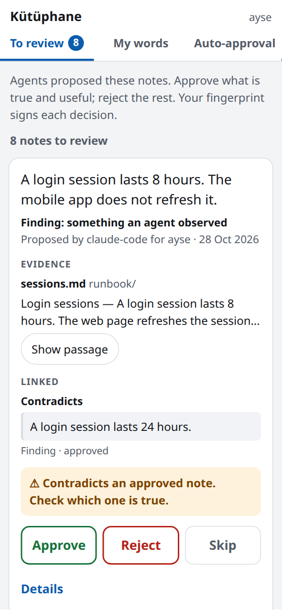
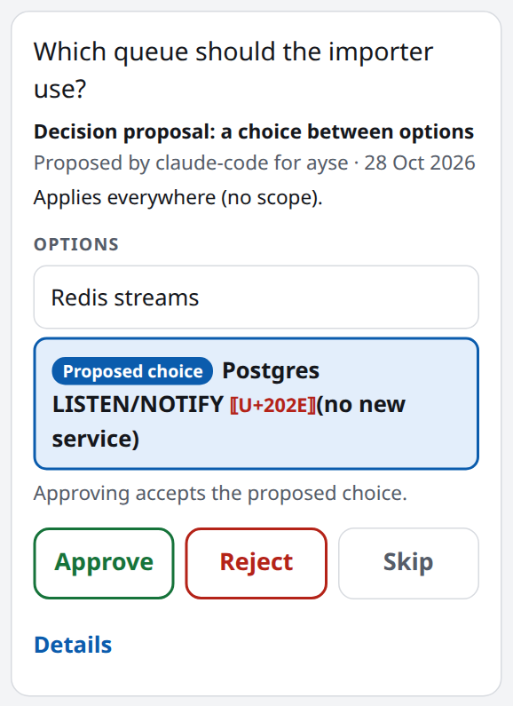
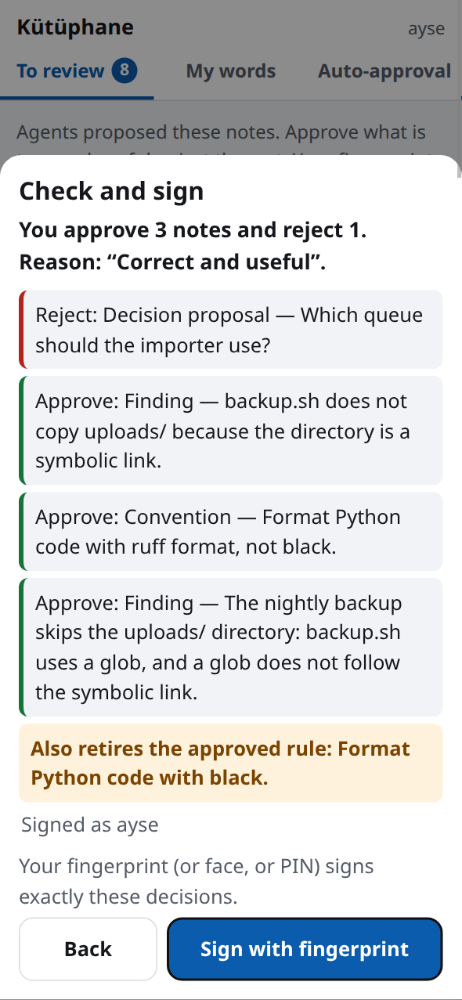

# Operations

This guide is for the operator. It shows how to run Kütüphane from the command line (`kutuphane`).
For the concepts, read [concepts.md](concepts.md). For the installation, read [install.md](install.md).

Every command prints JSON on stdout. Errors go to stderr.

| Exit code | Meaning |
|---|---|
| `0` | The command succeeded. |
| `1` | `index`: no embeddings route is set. `show`: no such book. `kstd-check`: the check failed or there is no `kstd.yaml`. |
| `2` | An error (bad input, policy error, database error), or `KUTUPHANE_CURATOR_DSN` is not set for a curator command. |
| `3` | `read`, `reopen`, `decisions export`, `note standing`, `note rollback`: access denied. `ingest`, `approve-import`, `index`: the version is live, but its index is incomplete. |
| `4` | `whoami`: the token is not valid. |
| `5` | `receive`: the package is not verified. |

## 1. Environment

### Database connections

| Variable | Role | Used by |
|---|---|---|
| `KUTUPHANE_DSN` | The app role `kutuphane_app`. This role cannot write Standing. | The server and every command, except the curator commands. |
| `KUTUPHANE_CURATOR_DSN` | The owner role. | `migrate`, `note standing`, `note rollback`. |

Keep `KUTUPHANE_CURATOR_DSN` out of every environment that an agent can read.
The `core` container in `compose.yaml` gets only `KUTUPHANE_DSN`.

Without `KUTUPHANE_CURATOR_DSN`, `migrate` uses `KUTUPHANE_DSN`. Use this only for a one-role development database.
`note standing` and `note rollback` stop with exit code 2 when `KUTUPHANE_CURATOR_DSN` is not set:

```
error: KUTUPHANE_CURATOR_DSN is not set (the curator credential)
```

To set up the app role:

1. Create the role once as the owner: `CREATE ROLE kutuphane_app LOGIN PASSWORD '…'`.
2. Put the password in `.env` as `KUTUPHANE_APP_DB_PASSWORD`.
3. After every `kutuphane migrate`, apply the grants as the owner:

```sh
kutuphane migrate
psql "$KUTUPHANE_CURATOR_DSN" -v ON_ERROR_STOP=1 -f deploy/db-roles.sql
```

The server does not start when the database schema does not match the code. Run `migrate` first.

### Variables

All `KUTUPHANE_*` variables that the code, `compose.yaml` and `deploy/` read:

| Variable | Default | Effect |
|---|---|---|
| `KUTUPHANE_DSN` | none (compose: app role at `postgres:5432/kutuphane`) | Database connection as the app role. Required. |
| `KUTUPHANE_CURATOR_DSN` | none | Owner connection for `migrate`, `note standing`, `note rollback`, `skill clear`. |
| `KUTUPHANE_DB_PASSWORD` | none (compose stops without it) | Password of the Postgres owner `kutuphane` in compose. |
| `KUTUPHANE_APP_DB_PASSWORD` | empty | Password of `kutuphane_app` in the compose `KUTUPHANE_DSN`. |
| `KUTUPHANE_PUBLIC_URL` | none | Public URL of the server. The server does not start without it. |
| `KUTUPHANE_BIND` | `127.0.0.1` | Host address of the ingress port `8080` in compose. |
| `KUTUPHANE_UI_DIR` | none | Directory of the web UI files that the server serves. Optional. |
| `KUTUPHANE_OIDC_ISSUER` | none | IdP issuer, exactly as the tokens carry it. Required by the server and `whoami`. |
| `KUTUPHANE_OIDC_AUDIENCE` | `kutuphane` | Expected token audience. |
| `KUTUPHANE_OIDC_JWKS` | compose: `/run/kutuphane/jwks.json` | Path of the JWKS file. Required. |
| `KUTUPHANE_OIDC_JWKS_FILE` | `./deploy/jwks.json` | Compose only: the host file that is mounted as the JWKS. |
| `KUTUPHANE_OIDC_ISSUERS` | none | Path of a JSON file with more token issuers, each bound to principal prefixes ([more than one token issuer](#more-than-one-token-issuer)). Set it for the CLI too: `grant … curate` reads it. |
| `KUTUPHANE_LLMDAP_URL` | compose: `http://llmdap:8787` | LLMDAP gateway URL. Without it, the server makes no model call: full-text search only, no answers ([light install](install.md#light-install)). |
| `KUTUPHANE_LLMDAP_KEY` | none | Core's LLMDAP subject key. |
| `KUTUPHANE_LLMDAP_ROUTE` | none | LLMDAP route for answers and question translation. |
| `KUTUPHANE_LLMDAP_ROUTE_CLASS` | compose: `local`; no default outside compose | `local` or `cloud`. A `local_only` book never goes to a `cloud` route. |
| `KUTUPHANE_ANSWER_MODEL` | none | Answer model on `KUTUPHANE_LLMDAP_ROUTE`. Required by the server when `KUTUPHANE_LLMDAP_URL` is set. `ask --model` sets it for the CLI. |
| `KUTUPHANE_LLMDAP_EMBED_ROUTE` | none | LLMDAP embeddings route. Without it, search is full text only. |
| `KUTUPHANE_LLMDAP_EMBED_ROUTE_CLASS` | compose: `local`; no default outside compose | Route class of the embeddings route. |
| `KUTUPHANE_EMBED_MODEL` | none | Pinned embedding model of the route, for example `BAAI/bge-m3`. |
| `KUTUPHANE_LLMDAP_RERANK_ROUTE` | none; local-models overlay: `rerank` | LLMDAP rerank route. Without it, there is no reranking. Local models: `rerank` (CPU) or `rerank-gpu` (GPU, [install.md](install.md#gpu-reranker)). |
| `KUTUPHANE_LLMDAP_RERANK_ROUTE_CLASS` | compose: `local`; no default outside compose | Route class of the rerank route. |
| `KUTUPHANE_RERANK_MODEL` | none | Pinned rerank model, for example `BAAI/bge-reranker-v2-m3`. |
| `KUTUPHANE_VLLM_IMAGE` | `vllm-node:latest` | Compose only (profile `gpu-rerank`): the local vLLM image of `reranker-gpu`. It is never pulled. |
| `KUTUPHANE_INDEX_BATCH` | `8` | Passages per embedding call. |
| `KUTUPHANE_INDEX_BATCH_CHARS` | `8000` | Embedded characters per call. A longer passage goes alone. |
| `KUTUPHANE_INDEX_CONCURRENCY` | `1` (at most 4) | Embedding calls in flight. |
| `KUTUPHANE_JOB_WORKERS` | `1` | Background answer workers in the server process. `0` runs no jobs. |
| `KUTUPHANE_NOTE_WRITES_PER_DAY` | `500` | Writes (notes, links, outcomes) per principal per day. |
| `KUTUPHANE_NOTE_DUP_SIMILARITY` | `0.90` | Vector similarity threshold for duplicate note candidates. |
| `KUTUPHANE_REPO_ROOTS` | compose: `/srv/repos` | Absolute directories, `:`-separated, that can hold code mirrors. |
| `KUTUPHANE_REPO_DIR` | `./deploy/repos` | Compose only: host directory mounted read-only at `/srv/repos`. |
| `KUTUPHANE_SIGNING_KEY` | none | Path of this installation's Ed25519 package signing key (`export`). |
| `KUTUPHANE_SKILLSPECTOR_BIN` | none | Path of the installed SkillSpector (`deploy/skillspector/install.sh`). Without it, skills are not scanned. |
| `KUTUPHANE_SKILLSPECTOR_ALLOW_VERSION` | none | One exact SkillSpector version that you allow in place of the tested one. |
| `KUTUPHANE_SKILLSPECTOR_TIMEOUT` | `120` | Seconds for each SkillSpector call. A timeout is a failed scan, and a failed scan blocks. |
| `KUTUPHANE_SKILLSPECTOR_PROXY` | none | Proxy for the SkillSpector subprocess. A dead port (`http://127.0.0.1:9`) blocks its OSV.dev requests. |
| `KUTUPHANE_DEV` | none | `1` enables `dev-keys` and `dev-token`. Set it on a development machine only. |
| `KUTUPHANE_PROBE_TOKEN` | none | Access token for `deploy/mcp_probe.py`. The probe never prints it. |

The CLI on the host reads no compose file (G13). A compose default that is also right on the host is the default of
the code too: `KUTUPHANE_OIDC_AUDIENCE` (`kutuphane`) and `KUTUPHANE_CONFIRM_HOURS` (`24`). An empty value counts as
not set, as in compose. The other compose values are container addresses and paths (`KUTUPHANE_DSN`,
`KUTUPHANE_CURATOR_WEB_DSN`, `KUTUPHANE_OIDC_JWKS`, `KUTUPHANE_LLMDAP_URL`, `KUTUPHANE_REPO_ROOTS`) or route classes.
Set them on the host. Without them, the command stops and its message names the variable.

A route class never has a default outside compose. `local` skips the egress check, so a wrong default would send
`local_only` text to a cloud route. Set `local` only for a route that keeps the data on premises. The CLI stops with
`LLMDAP not configured: set KUTUPHANE_LLMDAP_EMBED_ROUTE_CLASS (…: local or cloud …)` before it publishes anything.
The routes and models that `deploy/compose.local-models.yaml` sets are not defaults either: without
`KUTUPHANE_LLMDAP_EMBED_ROUTE` on the host, `search` and `ask` use full text only.

### More than one token issuer

The primary issuer is `KUTUPHANE_OIDC_ISSUER`, `KUTUPHANE_OIDC_AUDIENCE` and `KUTUPHANE_OIDC_JWKS`. To trust more
issuers (#157), for example a consumer application that signs tokens for its own users and services, write their
list in a JSON file and set `KUTUPHANE_OIDC_ISSUERS` to its path. The values below are placeholders: use the
issuer, audience and JWKS that the application's operator gives you.

```json
[{"issuer": "<the exact iss of the application's tokens>",
  "audience": "<the aud of its tokens, for example kutuphane>",
  "jwks": "/etc/kutuphane/<application>-jwks.json",
  "principal_prefixes": ["user:<application>.", "agent:<application>-"],
  "curate": false}]
```

| Key | Rule |
|---|---|
| `issuer` | Required. Compared exactly with `iss`, as for the primary issuer. Not the primary issuer, and each issuer once. |
| `audience` | Required. The `aud` that its tokens must carry. |
| `jwks` | Required. The path of its JWKS file. |
| `principal_prefixes` | Required, one or more. Each is `user:` or `agent:` and the start of a name in the principal alphabet (`a-z`, `0-9`, `.`, `_`, `@`, `-`). Its tokens may name only principals under these prefixes, and only its tokens may name them. The prefixes of two issuers never overlap. |
| `curate` | Optional, default `false`. With `false`, `kutuphane grant <book> curate <principal>` refuses a principal under its prefixes. |

A file that breaks a rule stops the server at start, and the message names `KUTUPHANE_OIDC_ISSUERS`. The grants of
these principals are made as for any other: `kutuphane grant book:<slug> read user:<application>.<name>`. With
compose, mount the file and each JWKS file into the `core` container, and give the container paths.

### A shared LLMDAP (D76)

One LLMDAP can serve Kütüphane and another product. Each product connects with its own subject key (D52) and has its
own policy lines; Kütüphane's subject is `svc-kutuphane`.

1. Set `KUTUPHANE_LLMDAP_URL` to the shared gateway. Core must reach it: a Core on the host reaches it directly. In
   `compose.yaml`, the `llmdap` service starts with the `app` profile and the `gateway` network is internal, so
   there is no compose mode without Kütüphane's own `llmdap` yet; the shared gateway must be on a network that the
   `core` container joins.
2. Put Kütüphane's subject key in `KUTUPHANE_LLMDAP_KEY`. Its hash goes in the shared gateway's keys file, next to
   the other product's subjects.
3. Set the route names of the shared gateway: `KUTUPHANE_LLMDAP_ROUTE` (answers and question translation),
   `KUTUPHANE_LLMDAP_EMBED_ROUTE`, `KUTUPHANE_LLMDAP_RERANK_ROUTE`, each with its route class and model. Each route
   needs a policy line `p, svc-kutuphane, llm:invoke, llm/<route>`.
4. Run `GET /v1/health`: each configured route gets one real call (purpose `health`).

Every call sends `x-llmdap-purpose` with one of `answer`, `search`, `index`, `translate`, `rerank`, `note`,
`decide` and `health`, so the shared chain shows what each call was for. The subject tells the products apart, so
the names have no product prefix. The LLMDAP correlation id of a call is `<our id>.<n>`, or
`<caller id>.<our id>.<n>` when the request had a caller id ([http-api.md](http-api.md#15-correlation-id)).

## 2. Ingest a folder into a book

```sh
kutuphane ingest <folder> --book <slug> \
  --sensitivity normal --egress local_only --protection standard
kutuphane show <slug>
```

| Option | Values | Meaning |
|---|---|---|
| `path` | a folder or a single file | The source. |
| `--book` | a slug, for example `kvkk` | The book. Required. |
| `--title` | text | The book title. |
| `--sensitivity` | `normal`, `restricted` | Required. |
| `--egress` | `local_only`, `cloud_ok` | Required. `local_only` text never goes to a `cloud` route. |
| `--protection` | `standard` | Required. |
| `--profile` | `chunked`, `whole` | The reading profile. |
| `--accept-finding` | `PATH@sha256:DIGEST:RULE` | Accept one reviewed credential-scan finding. Repeatable. |
| `--by` | a principal, for example `user:ayse` | Who publishes. Default: `user:<the CLI user>`. Recorded in the publication. |

Each `ingest` publishes a new version of the book. `show` lists the current versions and files of a book.
Each publication records who stood behind it (#160): `approved_by` and `channel` (`ingest`, or `import` for
`approve-import`, with `--by` as `approved_by`). `show` shows them. The book list (`GET /v1/books`, `list_books`), the
file list and `open_citation` show them too, and for a package also the signing key and the sequence. A publication
from before migration 045 shows `null`.

### What is searched

- Markdown.
- PDF text layers.
- `.txt`, `.json`, `.yaml`, `.toml`, `.sh`, `.py`, `.js`, `.ts`, `.xml`, `.csv` and `.mdc` as plain text.
- `.jsonl` and `.ndjson`: one passage for each record.
- `.html`: the visible text only. Scripts and styles stay out.

A file is text only if it is UTF-8 without NUL bytes. Text passages record their start `line`.
Kütüphane stores other files. People can read them, but search does not find them.

### What is quarantined

Kütüphane stores a file that it cannot extract, but it does not index the file. Examples:

- a PDF without a text layer;
- an unreadable or encrypted PDF;
- a text file that is not UTF-8.

`ingest` and `approve-import` report the file in `quarantined` and on stderr:

```
quarantined (stored, not indexed): <path>: <reason>
```

`show` lists the file. A new version that fixes the file indexes it.

### What is refused

These problems refuse the whole book:

- a `kstd.yaml` that cannot be read (an error in `kstd-check`). A claim that is not trusted (a warning in `kstd-check`, for example an unknown field or `assisted` without `reviewed_by`) does not refuse the book: see [kstd.md](kstd.md#validation);
- a symlink, a path violation or a size violation;
- markdown that is not UTF-8 or has invalid frontmatter;
- a credential-like file name (`credentials.json`, `*.env`, `id_rsa`, key stores, `settings.local.json`);
- credential-like text (keys, tokens, passwords, private key blocks);
- in a `cloud_ok` book only: a personal-data finding in a file that can go to a model (see [Personal-data and fleet-data findings](#personal-data-and-fleet-data-findings)).

The scan reads the original text and the extracted text. Placeholders (`${PASSWORD}`, `<your-key>`, `changeme`) and semantic constants (`token: refresh_token`) are not credentials.
The error gives the path, the line and the rule (for example `assigned-credential` or `api-key`). It never shows the matched text.

### Accept a reviewed finding

If a finding is a false positive, review it. Then accept it for exactly that file content:

```sh
sha256sum <folder>/<path>
kutuphane ingest <folder> --book <slug> --sensitivity normal --egress local_only --protection standard \
  --accept-finding '<path>@sha256:<digest>:<rule>'
```

- The acceptance covers the findings of that rule in that file content only.
- A changed file has a new digest. Kütüphane then refuses it again.
- An acceptance that matches no finding refuses the ingest.
- The publication records the accepted findings (`accepted_findings` in the result and in `show`). Stderr shows each one.
- `kstd-init` and `kstd-check` scan in the same way. Give them the same `--accept-finding` values.
- `receive` accepts nothing. The receiving installation scans again.

### Personal-data and fleet-data findings

`ingest`, `kstd-init` and `kstd-check` also look for personal data and fleet data. A finding is a labelling
question, not a credential leak, so it does not refuse a `local_only` book. These rules find it:

| Rule | Finds | Is not a finding |
|---|---|---|
| `private-ipv4` | 10/8, 172.16/12, 192.168/16, 100.64/10 (for example a tailnet) | a version (`v10.0.0.1`, `version: …`, `==10.1.0.2`), an OID, the block itself (`10.0.0.0/8`), loopback, link-local, the RFC 5737 documentation ranges, public addresses |
| `private-ipv6` | unique local addresses (fc00::/7) | the block itself (`fd00::/8`), loopback, link-local, `2001:db8::/32` |
| `email` | an e-mail address | `example.com`, `*.example`, `*.test`, `*.invalid`, `*.localhost`; no-reply addresses; `git@github.com:org/repo`; `icon@2x.png` |
| `phone` | `+` and 8–15 digits, a `tel:` URI, or a number after `tel`, `phone`, `telefon`, `gsm`, `mobile`, `cep`, `fax` | a time zone (`+0300`), an amount (`+10 000 000`), digits without `+` or a phone word |
| `listed-name` | a name of the `--deny-names` file | a name inside a longer word |

The deny-list file has one name per line (customers, sites, devices). A line that starts with `#` is a comment.
The match ignores case, and a space in a name matches any space. A name needs at least 3 characters. Keep the file
outside the folder: it is personal data itself.

```sh
kutuphane ingest <folder> --book <slug> --sensitivity normal --egress local_only --protection standard \
  --deny-names /secure/names.txt
```

- `ingest`, `kstd-init` and `kstd-check` report the same scan in the same way. Stderr lists each finding:
  `personal-data finding (labelling, not refused): <path> line <n> (<rule>)`. Then one line gives the count for
  each rule and the number of files, for example `personal-data findings: email 1, listed-name 44 (12 files)` (or
  `personal-data findings: none`). `ingest` writes this line to stderr; `kstd-init` and `kstd-check` write it to
  stdout. Give the three commands the same `--deny-names` file to get the same findings. The matched text is never
  shown or stored.
- The publication records the findings that no acceptance covers (`data_findings`: path, digest, rule, lines) in
  the result and in `show`. `kstd.yaml` is not scanned.
- `kstd-init` writes `personal_data: unknown` for the item of each file with a finding (see
  [kstd.md](kstd.md#personal-data-findings)).
- A `cloud_ok` book sends passages to cloud models. Every publication (`ingest` and `approve-import`, see
  [Packages](#10-packages)) refuses a file with a finding there, unless the file never goes to a model
  (`ai_use.ai_input` not `y` in `kstd.yaml`). Review each finding, then accept it as above
  (`--accept-finding '<path>@sha256:<digest>:email'`), set `ai_input: n` for the file, or use `--egress local_only`.
  An accepted finding is in `accepted_findings`.

### Hidden paths

Hidden paths stay out (`.git/`, `.env*`, dotfiles). These agent folders are the exception:

- `.claude/` (`agents`, `commands`, `rules`, `skills`, `hooks`, and `CLAUDE.md`);
- `.cursor/rules/`;
- `.github/` (`copilot-instructions.md`, `instructions/`, `prompts/`, `agents/`, `chatmodes/`);
- `.agents/` and `.codex/`.

### Agent instructions (K3)

Kütüphane marks these files as agent instructions:

- files in the agent folders above;
- files in a skill folder (next to a `SKILL.md`);
- files whose names start with `AGENTS.md`, `CLAUDE.md`, `GEMINI.md`, `SKILL.md` or `copilot-instructions.md`;
- Cursor `.mdc` rules;
- Copilot `.instructions.md`, `.prompt.md`, `.agent.md` and `.chatmode.md` files;
- files with a frontmatter type such as `skill`.

People read them with `read`. An agent also needs the `activate` mode.

### Skill scan (SkillSpector, D71)

Kütüphane can scan each skill folder (a folder with `SKILL.md`) with NVIDIA SkillSpector when you ingest a book,
re-scan it, or receive a package. SkillSpector is not part of Kütüphane. Install the tested version (the pin in
`deploy/skillspector/skillspector.pin`) into its own environment, and tell Kütüphane where it is:

```sh
deploy/skillspector/install.sh /opt/skillspector    # Python 3.12 or 3.13 (SKILLSPECTOR_PYTHON)
export KUTUPHANE_SKILLSPECTOR_BIN=/opt/skillspector/bin/skillspector
```

Without `KUTUPHANE_SKILLSPECTOR_BIN`, ingest works as before, and each skill is recorded as `not_scanned`.

`install.sh` installs every dependency and the build backend (`deploy/skillspector/build-requirements.txt`) as
wheels with hash checks, then builds SkillSpector without build isolation. For a host without network, download the
tag tarball and the wheels on another host, then set `SKILLSPECTOR_TARBALL=<tarball>` and
`SKILLSPECTOR_WHEELS=<folder with the wheels>`.

The result of a scan is a proposal to the curator (origin `tool`, `software_agent: skillspector <version>`), never
an approval:

| Result | Effect for agents |
|---|---|
| `DO_NOT_INSTALL` | blocked: no agent can activate any file of the skill |
| coverage not `complete` (for example missing referenced files) | blocked |
| the scan failed (a crash, a timeout, output that is not a valid report: more than 8 MiB, nested deeper than 64, a NUL, a lone surrogate, NaN) | blocked; the ingest continues |
| `CAUTION`, `SAFE` | no block; an agent still needs its `activate` grant (`SAFE` gives no right) |
| `not_scanned` (no tool, or a version that is not allowed) | no block |

People can still read a blocked skill with `read`. `ingest` prints `skill_scans` in its result and names each
blocked or not scanned skill on stderr.

```sh
kutuphane skill show <book>                    # scan results, findings, blocks and clearances of the current version
KUTUPHANE_CURATOR_DSN=… kutuphane skill clear <book> <skill-folder> --curator user:<name> --reason '…'
kutuphane skill rescan [--book <book>]         # scan again after a SkillSpector update
```

- `skill clear` is the curator act (section 7). It covers only those files and that scan report. A changed skill or
  a new SkillSpector version is a new proposal and can block again. A later `SAFE` scan never lifts a block.
- Kütüphane refuses a SkillSpector version that is not the tested one, unless `KUTUPHANE_SKILLSPECTOR_ALLOW_VERSION`
  names it. A scan with a new version marks the old results `stale`. The next ingest of that version, or
  `skill rescan`, scans again. A stale block stays until a curator clears it.
- A skill folder with the same bytes in a new version of the book reuses the earlier scan. Every block of those
  bytes that no curator cleared is copied to the new version (`carried_from` in `skill show`; `ingest` names it on
  stderr), whatever the new scan says. One `skill clear` lifts the block and all its copies.
- After you upgrade to a release with migration `022_skill_block_carry.sql`, run `kutuphane skill rescan`: it
  also copies the blocks of earlier versions to the current version of each book.
- A note that cites a blocked skill, or that is derived from such a note, has its text withheld from model readers
  and from the decision export (see [security.md](security.md#skill-scan-skillspector)).
- SkillSpector runs with `--no-llm` and a minimal environment (no API keys). It sends dependency names to
  api.osv.dev; see [security.md](security.md#skill-scan-skillspector).
- To check an installed SkillSpector: `KUTUPHANE_SKILLSPECTOR_BIN=… pytest tests/test_skillspector_contract.py`.

### kstd manifest

A folder can have a `kstd.yaml` manifest. It gives the rights, origin and validity of the files. Kütüphane enforces and shows them. Read [kstd.md](kstd.md).

```sh
kutuphane kstd-init <folder> --issuer 'ACME <kb@acme.example>'
kutuphane kstd-check <folder>
```

`kstd-init` and `kstd-check` do not use the database. `kstd-init` states no `ai_use` term: until you state the terms, no file is indexed or sent to a model. On a copy, add `--source-repo <repo>` (and `--commit <rev>` if the copy is older than `HEAD`): `kstd-init` then proposes `origin: model` or `unknown` from the commit trailers ([kstd.md](kstd.md#origin-proposals-from-a-source-repository)).

### Profile versions and re-ingest

A book that an older reader published keeps its old index. Ingest the book again to get the new reader (a new profile id).
Migration 011 marks the stored passages that the wider K3 rule makes instructions. These passages need `activate` at once.

### Re-index and note citations

A new profile or a new content version gives each passage a new handle. Notes cite passages and link to them
(`about`, `derived_from`) by the handle, so the publication maps each cited or linked passage of an earlier version to
the passage of the same path in the new version (#140):

1. `exact`: the passage with the same text.
2. `overlap`: else the passage that holds the largest share of its word pairs, at least half. This applies when only
   the profile changed (the same content, cut differently). When the content changed, `overlap` needs a passage that
   holds the whole old text, with its operators and case: one changed word (`enable` to `disable`) or operator (`>=`
   to `<=`) keeps most word pairs and changes the meaning.
3. `none`: else no successor. The notes show the citation as `stale` and keep it.

The `ingest` and `approve-import` result has the counts in `passage_map` (`passages`, `added`, `exact`, `overlap`,
`none`), and the command writes one line to stderr when a passage has no successor. The notes keep their handles;
`query_notes`, `neighbours`, `open_citation`, the curator queue and the decision export add `status` (`current`,
`moved`, `stale`) and, for `moved`, `moved_to` and `match` ([agent-memory.md](agent-memory.md#5-follow-links)).
A note written later on an older passage gets its map row in the same write.

For a book published before migration 040, map it once (idempotent; a stored row stays):

```sh
kutuphane reindex-map <book> [--dry-run]
```

The output has the same counts and `dry_run`; `--dry-run` counts and writes nothing (`added` is then what a run would
add). The map is append-only for the app role: apply `deploy/db-roles.sql` again after `migrate`.

## 3. Indexing

Hybrid search is optional. Set `KUTUPHANE_LLMDAP_EMBED_ROUTE`, `KUTUPHANE_LLMDAP_EMBED_ROUTE_CLASS` and `KUTUPHANE_EMBED_MODEL`.
Then `ingest` and `approve-import` embed the new version. `index` adds missing vectors:

```sh
kutuphane index <book> [--batch N] [--batch-chars N] [--concurrency N]
```

Without the embeddings route, `index` stops with exit code 1: `no embeddings route: set KUTUPHANE_LLMDAP_EMBED_ROUTE`.

- **Only changed passages are embedded (G17).** A vector records the sha256 of the embedded text. A new version copies the vector of each passage whose text, model and vector width did not change, in the same book, also from another profile of the book. So after a new chunker version, a new ingest embeds only the passages whose text changed. Vectors never go from one book to another. The result shows `vectors_embedded` (new vectors from the embedder) and `vectors_reused` (vectors copied from an unchanged passage, with no embedding call). Their sum is the number of vectors that the run wrote. A re-ingest that changes no passage text shows `vectors_embedded: 0`.
- **The book is live when it is published (G12).** An embedding settings error stops `ingest` and `approve-import` before the publication. If indexing fails after the publication, the command prints the publication result, adds `index_error` or `failed` and `not_attempted`, and exits with code 3. Run `kutuphane index <book>` later. `index` also exits with code 3 while passages are missing vectors.
- **Retries.** Kütüphane tries a failed embedding call 2 more times (after 5 s and 10 s). It reports a batch that still fails and continues. After 3 failed batches in a row, it stops and reports the rest as not attempted.
- **Indexing load (G18).** The local CPU embedder runs one request at a time. A search waits for the index call in front of it. `--batch`, `--batch-chars` and `--concurrency` override the `KUTUPHANE_INDEX_*` variables.

To index at a low priority, publish first. Then index later with smaller calls:

```sh
env -u KUTUPHANE_LLMDAP_EMBED_ROUTE kutuphane ingest <dir> --book <slug> …   # live now, full text search
KUTUPHANE_INDEX_BATCH=4 KUTUPHANE_INDEX_BATCH_CHARS=4000 kutuphane index <slug> # later, or at a quiet time
```

Smaller calls make the wait of a search shorter. They do not make indexing faster.
Keep the concurrency at 1 on the CPU embedder. `nice` and `ionice` do not help, because the embedder container does the work.

### Reranking

Reranking is optional. Set `KUTUPHANE_LLMDAP_RERANK_ROUTE`, `KUTUPHANE_LLMDAP_RERANK_ROUTE_CLASS` and `KUTUPHANE_RERANK_MODEL`.
The reranker reorders the top 30 hybrid hits. It reads the first 1,200 characters of each passage (G26).
With the local models, the route `rerank-gpu` runs the same reranker on the GPU: 0.2–0.3 s for 30 passages instead of
11–25 s on the CPU, with the same top 8 ([install.md](install.md#gpu-reranker)). The route `rerank` (CPU) is the fallback.

## 4. Search and ask from the CLI

```sh
kutuphane search <principal> '<query>' [-k K] [--on-behalf-of user:<name>]
kutuphane ask <principal> '<question>' --model <model> [--on-behalf-of user:<name>]
kutuphane reopen <principal> <answer_id>
kutuphane read <principal> <book> <content_id> <path>
```

- The principal is `user:<name>` or `agent:<name>`. For an agent that acts for a person, give `--on-behalf-of user:<name>`.
- `search` returns `citation`, `page`, `line`, `score`, `text`, `item` (the kstd rights) and `quoted_records` (the JSONL records that the passage repeats, [concepts.md](concepts.md#records-that-a-passage-repeats)). `-k` is 8 by default, from 1 to 50.
- `ask` needs the LLMDAP variables. On the host, this includes the route class of each route that you set (§1). It prints the answer and its `correlation_id`.
- `reopen` shows a stored answer and its evidence again. It does not call a model.
- `read` writes the file bytes to stdout through the authorization gate.

### Scope filters (G14)

`search` and `ask` take the same filters. The filters narrow the evidence before ranking.

| Option | Meaning |
|---|---|
| `--book <slug>` | Only this book. Repeatable. |
| `--path <prefix>` | Only files whose path starts with the prefix, for example `data/`. |
| `--origin <origin>` | Only files with this kstd origin: `human`, `assisted`, `model`, `tool`, `unknown`. Repeatable. A book without `kstd.yaml` counts as `unknown`. |
| `--current-only` | Only files whose kstd validity includes now. |
| `--platform <name>` | The request context (#137): leave out the files whose kstd `applies_to` names other platforms. |
| `--version <version>` | The request context: leave out the files whose `applies_to` version range does not hold this version (for example `7.0.3`). |

A filter never adds a book. A book that the caller cannot read gives the same empty result as a book that does not exist.

**Request context and `applies_to` (docs/09, Scope).** A file without `applies_to` is unbounded: it matches every
request. A file with `applies_to` is bounded:

- When the context contradicts a bound (another platform, a version outside the range), the file is left out before ranking, so it never takes a place in `k`.
- When the request gives no value for a bound (no context, or a platform but no version), the file stays in the evidence. Its `item.scope` is `needs_context`.
- `item.scope` is `unbounded`, `match` or `needs_context` in each result and citation. `open_citation` and a stored answer have no context, so a bounded file shows `needs_context` there.

A file of a book has no Role (docs/09) today: every passage is evidence, and no passage has rule authority. A bounded
journal `rule` note without a matching context is not current in `query_notes` (`excluded.needs_context`); the same
rule decides `item.scope` here.

### One book per scope (#138)

Grants are for a whole book (G10: item-level access is not built). For roles that see only one scope, for example
the operators of one device group:

1. Put the content of each scope in its own book (`site-kayseri`, `site-ankara`).
2. Put the content that every scope uses in one more book (`shared`).
3. Give each role `read` on its scope book and on `shared`. Do the same for journals: one journal for each scope, and one shared journal.
4. Search without a `book` filter, or name the scope book and `shared` (`--book site-kayseri --book shared`). One call searches both books.

The pre-filter reads only the books that the caller may read, before ranking. So a role with grants on scope A
never gets a scope-B passage or note from `search`, the evidence of `ask`, `open_citation`, `neighbours` or
`query_notes`; a link to a note of scope B is not shown (`tests/test_book_per_scope.py`). Keep the shared part in
one book: do not copy it into each scope book.

### Answers

- The answer is in the language of the question (Turkish or English; G20). It is short (about 150 words).
- The answer model gets the first 2,400 characters of each passage. The stored sources and citations keep the whole passage (G26).
- A reference names one or more passages: `[2]`, `[2,3]`, `[2-4]`, `[2–4]` (G21). One unknown number or one malformed group (`[1-2-3]`) refuses the answer.
- Each citation gives `line`, the line where the passage starts, as `search` does (`null` for HTML and PDF). A JSONL passage also gives `record`: the number of its record in the file, from 1. Blank lines are not records. With the `whole` profile, one passage holds the whole file, so `record` is `null` unless the file has one record (G15). The evidence of `reopen` and of a background job's result gives them too, also for an answer from before G15.

### Two languages (G19)

When the passages are in Turkish and in English, the answer model translates the question. Only the question goes to the model.
The translation uses greedy decoding (`temperature` 0): the question gets the most likely translation, not a sampled one.
A second search runs with the translation. Kütüphane authorizes the merged passages again. Each passage is reranked against the question in its own language.
Without a translation, up to 2 passages in the other language from the hybrid top 8 keep a place.

### Recent things (G22)

A question with words such as "recent", "latest", "son" or "en yeni" ranks the 16 most relevant passages by relevance and date.
The date is the kstd `valid_from`. If there is none, it is the first date or ISO week in the path (`brief-2026-W40.json`). If there is none, it is the `classified_at` field of a JSONL record.
Kütüphane never uses a date from the text. It ignores a date later than tomorrow.

kstd `valid_from` and `valid_to` keep their time. `2026-10-27T23:59:00Z` is not current at noon that day. A date alone means 00:00 UTC.

### Limits

- A question or query is at most 1,000 characters.
- Each process keeps query vectors in memory (256 queries, 4 MiB at most). A repeated query needs no embedding call.

## 5. Trust, grants and delegations

### Grants

```sh
kutuphane grant book:<slug> <mode> <subject>
kutuphane revoke book:<slug> <mode> <subject>
kutuphane grant role:<name> member user:<name>
```

| Mode | Meaning |
|---|---|
| `discover` | Reserved. You can grant it, but no code path checks it today. |
| `read` | Read and search the book. |
| `use` | Reserved. You can grant it, but no code path checks it today. |
| `activate` | An agent can use agent instructions (K3) from the book. |
| `propose` | Write notes, links and outcomes in a journal. |
| `curate` | Change the Standing of notes. Give it to users only. It is never delegated. `grant … curate …` needs `KUTUPHANE_CURATOR_DSN` (the curator credential); without it the CLI refuses with exit code 2. |
| `member` | With `role:<name>`: add the subject to the role. |

The subject is `user:<name>`, `agent:<name>` or `role:<name>#member`.
`grant` prints the grant `id`. `revoke` prints `revoked`.

### Delegations

An agent that acts for a person needs a live delegation from that person:

```sh
kutuphane delegate user:<name> agent:<name> book:<slug> read --hours 8 --purpose '<why>'
kutuphane undelegate <id>
```

A delegation is time-boxed and has one level. `delegate` prints the `id` and `expires_at`.
A delegation can carry `discover`, `read`, `use`, `activate` or `propose`. The CLI and the database refuse a delegation of `curate`.

### Signing keys

```sh
kutuphane keygen <private_key>
kutuphane trust <public_key> --fingerprint <fingerprint> --name <name> --by user:admin
kutuphane untrust <fingerprint>
```

Confirm the fingerprint out of band before you run `trust`.

### Development tokens

`dev-keys` and `dev-token` need `KUTUPHANE_DEV=1`. Use them on a development machine only.

```sh
KUTUPHANE_DEV=1 kutuphane dev-keys <directory>
KUTUPHANE_DEV=1 kutuphane dev-token <sub> --private-key <key> --issuer <issuer> [--audience <aud>] [--agent] [--act <agent>] [--client-id <id>]
```

`dev-keys` writes a private key (mode 600) and the matching JWKS. Point `KUTUPHANE_OIDC_JWKS` at the JWKS.
Read [security.md](security.md) for the production identity setup.

## 6. Journals

A journal is a book whose items are agent notes. Read [agent-memory.md](agent-memory.md).

```sh
kutuphane journal create adc-memory --search y --ai-input y \
  --sensitivity normal --egress local_only --protection standard --by user:admin
kutuphane grant book:adc-memory propose agent:adc
kutuphane grant book:adc-memory curate user:ayse
```

| Option | Meaning |
|---|---|
| `book` | The journal slug. |
| `--title` | The title. The default is the slug. |
| `--search {y,n}` | Notes get full text and vectors. Required. |
| `--ai-input {y,n}` | Note text can go to models. Required. |
| `--train {y,n}` | Note text can be exported as training data. The default is `n`. |
| `--sensitivity`, `--egress`, `--protection` | The policy, as for `ingest`. Required. |
| `--by` | The administrator, for example `user:admin`. Required. |

`journal restrict <book>` tightens a journal with `--no-search`, `--no-ai-input` and `--no-train`. To loosen a journal, create a new journal.

A journal never gets a content version: `ingest` and `approve-import` into a journal slug are refused.

### Private journals (customer-confidential project memory)

Use a private journal when the project memory contains customer-confidential material and must not leave this installation.
A private journal is a journal with `--sensitivity restricted --egress local_only`:

```sh
kutuphane journal create acme-memory --search y --ai-input y \
  --sensitivity restricted --egress local_only --protection standard --by user:admin
```

| Path | What Kütüphane does |
|---|---|
| Package (`export`) | Refused. A journal has no content version, and a `restricted` book is never in a package. Packages are the only path to another installation. |
| Publication (`ingest`, `approve-import`) | Refused for a journal slug. |
| Decision export | The note is left out. This applies also to each note, in any journal, with a `derived_from` link to a private journal note (also through other notes). The summary counts them in `restricted`. |
| Training (`--train y`) | Refused at `journal create` for a `restricted` journal. |
| Kütüphane's own model calls (embeddings, answers) | Only `local` routes. A `cloud` route is refused before the call (`not_sent:egress_policy`), also for a note that derives from the private journal. |
| Agents through MCP and HTTP | Only principals with `read` get the text. Kütüphane cannot see where an agent's model runs. Give `read` only to agents whose model runs locally, or create the journal with `--ai-input n`: then model readers get `text: null`. |

### Import a local memory

An orchestrator that kept its memory locally (for example nöbetçi-mcp in SQLite) moves it into a journal once:

```sh
kutuphane grant book:nobetci-memory propose user:ayse
kutuphane note import nobetci-memory nobetci.jsonl --by user:ayse
```

- The file has one JSON record on each line. The format is in [agent-memory.md](agent-memory.md), section 11.
- `--by` is the importer. It needs `propose` on the journal, and `read` on each book that a citation or a `ref` link names. A `user:` importer gives origin `unknown`; an `agent:` importer gives origin `model`.
- Each record becomes a `pending` note. A curator accepts it later (section 7).
- Kütüphane validates the full file first. If a line is wrong, the command writes nothing and names the line (at most 5 lines in the message).
- All records go in one transaction: all or none.
- A record id that was imported before is not written again. The same file again gives `unchanged` for each record.
- A file has at most 10,000 records and 64 MiB. Split a larger file.
- The import has no daily write limit. It does not use the importer's MCP and HTTP write limit.
- With an embeddings route (`KUTUPHANE_LLMDAP_EMBED_ROUTE`), each new note gets a vector after the commit, with the egress check.
- There is no MCP tool and no HTTP route for the import. An agent writes one note at a time with `propose_note`.
- The command prints a report: `created`, `existing` (the same bytes were already a note), `unchanged`, `links` and one item for each record. Exit code 3: no right, or the book is not a journal; 2: the file is refused.

## 7. Curation

A note starts `pending`. Only a curator changes its Standing: on the command line, or on the phone with a passkey
(curator web, below). The curator needs `curate` on the book (and `read` on the phone).
The CLI commands need `KUTUPHANE_CURATOR_DSN`.
The same credential and right lift a skill scan block: `kutuphane skill clear` (section 2, "Skill scan").

```sh
KUTUPHANE_CURATOR_DSN=… kutuphane note standing adc-memory@nt_<64 hex> approved --curator user:ayse --reason '…'
KUTUPHANE_CURATOR_DSN=… kutuphane note rollback adc-memory@nt_<64 hex> --curator user:ayse --reason '…'
```

`note standing` sets `approved`, `pending`, `rejected` or `retired`. The allowed changes are:

| From | To |
|---|---|
| `pending` | `approved`, `rejected` |
| `approved` | `retired` |
| `rejected` | `pending` |
| `retired` | `pending` |

`note rollback` is for a poisoned note. It retires the note and every note derived from it in one transaction.
A root note that was ever approved becomes `retired`. A pending root becomes `rejected`.
Derived notes that are `approved` or `pending` become `retired`.

Rollback prints:

| Field | Content |
|---|---|
| `root` | The note reference. |
| `event_seq` | The Standing event of the root. |
| `notes` | Each note: `ref`, `was`, `standing`, `event_seq`, `writers` (`principal`, `on_behalf_of`, `client_id`). |
| `deliveries` | Reads that held the notes: `at`, `action`, `principal`, `on_behalf_of`, `correlation_id`, `memory_seq`, `items`. |
| `answers` | Answers that used the notes: `id`, `at`, `principal`, `on_behalf_of`, `refs`. |
| `exports` | Exports that held the notes, in the same form as `deliveries`. |

Use this report to tell the users and agents that used the notes.

### The queue (#77)

The queue lists the pending notes of a curator in risk order. The phone page and the CLI show the same queue:

```sh
KUTUPHANE_CURATOR_DSN=… kutuphane curator queue --curator user:ayse [--book adc-memory] [--as-of W] [--cursor C]
```

- **Books:** only the books where the curator holds `curate` and `read` directly, now. A book with `curate` but no
  `read` is in `read_needed` ("grant read to curate this book").
- **Groups:** the pending notes of one `same_as` cluster are one group. A group shows every member, also the decided
  ones, with its Standing. Members joined by `contradicts` are in `pairs`.
- **Order:** groups by tier, then by the oldest pending note. Inside a group, by seq.

| Tier | Notes |
|---|---|
| 1 | a rule note whose approval retires an approved rule of the same scope (`supersedes`); any note with a `contradicts` link to an approved note |
| 2 | `decision_proposal` |
| 3 | `convention` |
| 4 | `finding` |
| 5 | `lesson`, `dead_end` |
| 6 | `test_result` |

- **Watermark:** the output has `watermark` (w). The same w and the same rights give the same queue, byte for byte.
  `next_cursor` gives the next page at the same w (20 groups per page; `--limit` changes it).
- **Each note** shows every part that its id covers: the text, the scope, the class key, the commit, the decision
  options and choice, the citations, and the links with the target text. It also shows "why here", the writers, the
  origin, the outcome counts, and per group the recurrence and "proposed again after rejection". A readable passage
  citation has its `path`, an `excerpt` (the first 240 characters, Markdown heading marks removed; the full text is in
  `/api/note`) and its `status` after a re-index (`current`, `moved` with `moved_to` and `match`, or `stale`; the card
  says "re-indexed" or "not in the current version"); a passage link has its `path`, the full `text` and the same
  `status`. A citation or a link into a book that the curator cannot read shows only "a passage (note) in a book you
  cannot read", with no path.
  `hidden_parts` counts these parts in the note's own citations and creation links: such a note cannot be approved
  on the phone (the curator can reject it, or get `read` on that book).
- Each queue page is recorded as an `access_event` (action `curate_view`) with the notes and their Standing events,
  so the rollback report can list who saw a note.

### On the phone (curator web, D72)

Install it first: [install.md](install.md#curator-web). Then, for each curator:

```sh
KUTUPHANE_CURATOR_DSN=… kutuphane curator enroll user:ayse
```

The command prints a one-time URL (valid 15 minutes, for one passkey). Give it to Ayşe on a private channel. She
opens it on her phone (with the Tailscale app on), taps **Create passkey** and confirms with her face, fingerprint or
PIN. Then she taps **Sign in with passkey**.

The page has two tabs: **To review** (the queue above) and **My words** (the "my words" requests, below). Each tab
has one line that tells what it is for. The words on the page
are plain English; the internal names (refs, class keys, tiers, writer ids) are under **Details** on each card,
closed by default.



**A card**, from top to bottom (one card per note, or per group of notes that say the same thing):

1. the note text, large (hidden Unicode characters are shown as marks such as `⟦U+202E⟧`);
2. the kind in plain words ("Finding: something an agent observed", "Convention: a rule the team should
   follow", "Decision proposal: a choice between options", "Lesson", "Dead end: an approach that did not work",
   "Test result"), who proposed it for whom, and the date; then where it applies ("Applies to kutuphane: src",
   "Applies to vcenter; version >=7,<8" for an `applies_to` bound, "Applies everywhere (no scope)." for a rule
   with neither bound) and the commit it saw;
3. **Evidence**: each cited passage as its file name and the first two lines; **Show passage** opens the full text.
   A passage in a book that the curator cannot read shows only "A passage in a book you cannot read";
4. **Options**: the options of a decision proposal, with the **Proposed choice** marked. It is always open;
5. **Replaces**: the text of the approved rule that this note replaces, and **Linked**: the text of every other
   linked note or passage;
6. a warning line instead of the tier: "Approving this replaces an approved rule.", "Contradicts an approved note.
   Check which one is true.";
7. **Approve**, **Reject** and **Skip**. A note with a part in a book that the curator cannot read has no
   **Approve** (she can reject it, or get `read` on that book);
8. **Details** (closed): the note id, the kind, the scope, the class key, the commit, the writers, the origin, the
   outcomes and "why here".



A group card says "3 notes say the same thing" and has **Approve all** and **Reject all** (no **Approve all** when
two members contradict each other or more than one is a rule). Each member also has its own buttons.

The bottom bar shows the counts ("2 approve · 1 reject") and **Sign 3 decisions**. A tap asks **Why?**: she taps a
reason (**Correct and useful**, **Wrong**, **Duplicate**, **Not useful now**) or writes one; **Not sure — skip**
clears the choices and signs nothing. **Continue** shows the sign sheet from the stored statement: "You approve 2
notes and reject 1. Reason: …", each note (its kind and first line), and "Also retires the approved rule: …" for each
rule that an approval retires. She taps **Sign with fingerprint** (or face, or PIN). One act decides every chosen
note, with one reason; each note gets its own Standing event. The passkey signs that exact statement: the notes, their
digests, the Standing in force, the new values and the reason. If another curator acted on a note in between, the
page says so and reloads.



After the act, the page shows the receipt ("Done. 2 approved, 1 rejected."): for each note, what was decided and the
rules that an approval retired. "Nothing to review." means the queue is empty.

Rules of one act: 1–50 notes, one reason, at most one rule-role note (`decision_proposal`, `convention`) approved,
never two notes joined by `contradicts` approved together. The transitions are the ones in the table above. iPhone
and iCloud passkeys are synced; that is allowed, and each act records it.

```sh
KUTUPHANE_CURATOR_DSN=… kutuphane curator passkeys [user:ayse]     # the passkeys: synced or not, last act
KUTUPHANE_CURATOR_DSN=… kutuphane curator revoke-passkey <id>      # a lost phone: revoke, then enroll again
KUTUPHANE_CURATOR_DSN=… kutuphane curator end-sessions user:ayse    # a stolen cookie: end all her sessions
KUTUPHANE_CURATOR_DSN=… kutuphane curator cancel-enrollment <en_…>  # a leaked code: cancel it before it is used
KUTUPHANE_CURATOR_DSN=… KUTUPHANE_WEBAUTHN_RP_ID=… KUTUPHANE_WEBAUTHN_ORIGIN=… kutuphane curator verify-acts
```

`revoke-passkey` also ends every session of that passkey at once; a session of a revoked passkey is refused in any
case. `cancel-enrollment` takes the enrollment id that `curator enroll` printed; the code then opens no session, and
an open enrollment session of that code ends. A used code cannot be cancelled: revoke its passkey. An enrollment
session registers a passkey only for its own code.

After each enrollment, check `curator passkeys`: one new passkey per enrollment that you made. `verify-acts` checks
every stored act again, offline: the statement gives the challenge, the signature verifies with user verification
against the stored passkey, and the rows of the act (Standing events, origin confirmations and withdrawals) are
exactly the items of its statement, and the
retirements that they caused are exactly its `retires`. It also checks that each note that an approval or a
confirmation signed still has the parts (text, citations, creation links) that give its signed id; a mismatch is the
problem `contents`. It exits 1 and lists the act when a check fails.

The citations and the creation links of a note are part of its id, so the database writes them only together with the
note (migration 039). An approval on the phone, and a confirmation, count only while the note's stored parts give the
id that the person signed. Else the note shows `pending` and the origin of the write path (`model`).

### "My words": confirm the origin of a note (D70 R3, R7)

> **Frozen (D78).** "My words" works as described below, but it gets no new work.

The server never stores `human` from a token. When an agent (or a person over HTTP) proposes a note with
`origin: human` or `assisted`, the note gets the write-path origin (`model` or `unknown`) with the notice
`origin-claim-refused`, and the receipt gets a confirmation URL: `<KUTUPHANE_CURATOR_URL>/c/<book>/<nt_id>`. The
MCP tool `confirm_origin` gives the same URL to the agent; a 2026-07-28 client shows it to the person as a URL
elicitation. The URL holds no secret and gives no right.

The person opens the URL in curator web (or the **My words** tab, `/requests`, for every open request), signs in
with a passkey, and reads the full text first, then who typed it (the writer and the client) and the fields of the
note. Then the person picks one sentence and taps **Sign with fingerprint**:

| Choice | Origin | Who may choose it |
|---|---|---|
| "These are my words, verbatim (I wrote or dictated them)." | `human` | only the person the words were entered for: the user that the agent acted for, or the user who wrote (a database key) |
| "A model wrote or reworded this. I reviewed it in substance." | `assisted` | that person, or a curator of the book |

The person also needs `read` on the book: without it, the page and the act refuse with the same answer for every
note, whether it exists or not. Nothing is stored before the signature; leaving the page stores nothing.

- **Expiry:** a request is open for `KUTUPHANE_CONFIRM_HOURS` (24) hours after its write. Then the page refuses it.
  The same bytes proposed again open a new request. A confirmation itself does not expire.
- **One changed byte** is another note, with the write-path origin. A confirmation never moves to another note,
  also not to the note that supersedes it.
- **What readers see:** `query_notes`, `neighbours`, `open_citation` and the decision export give the shown origin,
  and with a live confirmation also `entered_by` and `confirmed_by`. The `origin` filter uses the shown origin.
  `write_record.origin` never changes. The origin changes no Standing and no right.
- **Withdraw (R7):** only the person who confirmed can withdraw, on the same page (**Withdraw my confirmation**, a
  passkey act). Then the origin is the write-path value again; an older confirmation does not come back. A query
  with `as_of` before the withdrawal still shows the confirmation. Other people use the Standing path (reject or
  retire).
- **A live confirmation stays:** while it is live, no other person can confirm the note, also not through a new
  request for the same bytes. The page offers no choice; the act and the database refuse. The confirmer may confirm
  again (the latest counts) or withdraw first.

### Measures

```sh
KUTUPHANE_CURATOR_DSN=… kutuphane curator report --from 2026-10-01 --to 2026-11-01
```

`--from` is included, `--to` is not; a date with no zone is UTC. The report is read only.

| Key | Content |
|---|---|
| `curator_time` | `seconds_per_approved_note`: the visible time of the phone acts that approve a note (from the first display of the cards to the tap on **Continue** after the reason, only while the tab is visible, at most 1 hour) ÷ the notes they approve. Also the median seconds per act and per decided note, the acts with no time, and the acts signed by a synced passkey. |
| `pending_after_7_days` | Among the notes written from `--from` to 7 days before `--to` (and at least 7 days ago): the share with no Standing event 7 days after it was written. By tier (the tier now) and by book. |
| `decided_by` | Standing events in the period: `people_web` (phone acts), `people_cli`, `system`, by value. |

## 8. Outcomes and decision export

Agents record outcomes with `record_outcome` (MCP) or `POST /v1/outcomes`. There is no CLI command for this. Read [mcp.md](mcp.md) and [http-api.md](http-api.md).

- An outcome is `passed`, `failed`, `reverted` or `reopened` for a task on one exact note or passage version.
- The writer needs `propose` and `read` on the book and an `idempotency_key`.
- Reads show the counts in an `outcomes` field: for example `{"passed": 2, "failed": 1}`. Only non-zero counts show.
- An outcome never changes the Standing.

Export decision records:

```sh
kutuphane decisions export <principal> --out decisions.jsonl [--book <journal>] [--on-behalf-of user:<name>]
```

- `--out` must be a new file. The command creates it with mode 600.
- Without `--book`, the export includes every journal that the principal can read.
- The text, options and choice are present only when the note allows `ai_input` and `train` (`journal create --train y`) and the note does not depend on a skill that a scan blocks. Otherwise the record has only references and hashes, and `withheld` gives the reason.
- `context.passages` gives each kept passage handle (citations and links) its state now: `{"status": "current"}`, `{"status": "moved", "moved_to": …, "match": "exact"|"overlap"}` or `{"status": "stale"}` (#140). The handles in `citations` and `links` stay as written.
- A note with a `restricted` book in its sources is not in the export. The summary counts these notes in `restricted`.
- A note derived from a file with `license: unknown` is not in the export (#143). "Derived" means: the note cites a
  passage of that file, has a `derived_from` link to it, or has a `derived_from` link to a note that is derived from
  it. The summary counts these notes in `licence_unknown`. Set `rights.license` in the `kstd.yaml` of the source
  book, then publish it again, to export them.

## 9. Code repositories

A journal can cite code in a Git repository. Kütüphane never fetches.

```sh
kutuphane repo add <journal> <slug> /srv/repos/<name>.git --ref 'refs/heads/*' --by user:admin
kutuphane repo remove <journal> <slug>
```

- `git_dir` is the absolute path of a bare mirror. Its path has no symlink.
- `--ref` is a ref pattern whose commits can be cited. Repeatable, at most 10. Only commits that these patterns reach can be cited.
- The mirror must be inside `KUTUPHANE_REPO_ROOTS`. Compose mounts `KUTUPHANE_REPO_DIR` (default `./deploy/repos`) read-only at `/srv/repos`.
- The mirror has no alternates, no `commondir` and no promisor pack. Its `config` has only plain `core.*`, `extensions.objectformat` and `remote.*` url/fetch/mirror keys.
- `repo remove` stops new scopes and citations. Verification of old citations then gives `unverifiable`.
- The server needs git 2.45 or later. The container image checks this at build time.

Keep the mirror current yourself, for example with cron:

```cron
*/15 * * * * git --git-dir=/srv/kutuphane/repos/app.git fetch --prune --quiet
```

## 10. Packages

A package is a signed copy of a book's current version. Read [kstd.md](kstd.md).

On the sending installation:

```sh
KUTUPHANE_SIGNING_KEY=/path/key.pem kutuphane export <book> --out <book>.pkg [--legal-basis 'eu-gdpr:A6-1-b']
```

`--legal-basis` is required when `kstd.yaml` marks files as personal data `yes` or `unknown`.

`export` refuses a journal and a book with `--sensitivity restricted`: restricted content never leaves this installation in a package.

`export` refuses a book that has a file with `license: unknown` in its `kstd.yaml` (#143). The error names the
files. Derivation inside this installation is permitted; export and forwarding need a license. Set
`rights.license` (or the license of each item), for example `LicenseRef-InfraMedic-Internal` for internal
content, and publish the book again.

On the receiving installation:

```sh
kutuphane receive <book>.pkg
kutuphane imports
kutuphane approve-import <id> --by user:admin --sensitivity normal --egress local_only --protection standard
kutuphane reject-import <id> --by user:admin --reason '…'
```

- `receive` quarantines and verifies the package. It publishes nothing. It exits with code 5 if the status is not `verified`.
- `imports` lists the last 50 received packages and their verdicts. A package that came over HTTP or MCP also shows
  `submitted_by`, `submitted_for` and `submitted_channel` (the caller of the token). A CLI `receive` has none.
- `approve-import` publishes the package with this installation's policy. It indexes like `ingest` (exit code 3 if the index is incomplete).
- `reject-import` refuses the package. Kütüphane keeps the record.
- `receive` adds a `personal_data` finding for each open personal-data or fleet-data finding (path, file digest, rule,
  lines; never the matched text). With `--egress cloud_ok`, `approve-import` refuses a file with a finding that can go
  to a model, as `ingest` does, until you accept each reviewed finding:
  `--accept-finding '<path>@sha256:<digest>:<rule>'` (repeatable). The refusal is in the reasons of the import, and
  you can approve again. An accepted finding is in `accepted_findings` of the publication.
- With `KUTUPHANE_SKILLSPECTOR_BIN`, `receive` adds a `skill_scan` finding for each skill folder (status, blocking,
  recommendation, score, completeness, issue count). The publication at `approve-import` records the scans that
  block agents.

### Packages from an application (HTTP and MCP, #139)

An application can send a signed package without the CLI: `POST /v1/packages`
([http-api.md](http-api.md#12-packages)) or the MCP tool `submit_package` ([mcp.md](mcp.md#516-submit_package)).
The checks are the same as `receive`. Nothing is published: a person still runs `approve-import` (no route and no
tool approves).

1. Trust the signing key of the application once (section 5, `trust`).
2. Give the principal of the application `propose` on the target book. There is no new grant mode:

   ```sh
   kutuphane grant book:<book> propose agent:<client>
   ```

   A principal without `propose` on the book that the manifest names gets `403`, and Kütüphane stores nothing. A
   journal is never a target (`400`).
3. The issuer of the files is the key that signed the package (D74). The origin of each file comes from the signed
   `kstd.yaml`. The caller is only recorded (`submitted_by`, D70): a client-credentials token is an agent, and it
   does not change the issuer or the origins.

#### Consumer application guide (example: InfraMedic)

1. **Sign.** InfraMedic keeps its knowledge (runbooks, problem packs) as a book in its own Kütüphane installation,
   with a `kstd.yaml`. Set a license, for example `license: LicenseRef-InfraMedic-Internal`: a file with
   `license: unknown` is never exported. After its own human gate, InfraMedic publishes the new version and signs
   it: `KUTUPHANE_SIGNING_KEY=… kutuphane export runbooks --out runbooks.pkg`. Each export has a new sequence.
2. **Submit.** InfraMedic gets a client-credentials token and sends the package:

   ```sh
   curl -s -X POST -H "Authorization: Bearer $TOKEN" -H "Content-Type: application/x-tar" \
     --data-binary @runbooks.pkg "$KUTUPHANE_PUBLIC_URL/v1/packages"
   ```

   The response has the import `id` and `status`: `received`, `findings`, or `refused` with the `reasons`.
   `GET /v1/packages/<id>` gives the status again, and `approved` after the approval.
3. **A person approves.** The operator reads `kutuphane imports` (the findings and the diff: `added`, `removed`,
   `changed`) and runs `kutuphane approve-import <id> --by user:<name> …` or `reject-import`.
4. **Indexed.** `approve-import` publishes the version and indexes it. Only the passages whose text changed are
   embedded again; every unchanged passage copies its vector (section 3). Search finds the new text after the
   approval, not before.

Run state (saga outcomes, task results) is not a book: record it with `record_outcome` or in a journal.

## 11. Audit and logs

```sh
echo "$TOKEN" | kutuphane whoami
kutuphane explain <correlation_id> --llmdap-export audit.jsonl
kutuphane explain <answer_id> --answer --llmdap-export audit.jsonl
```

- `whoami` reads the token from stdin, never from the command line. It prints `principal` and `on_behalf_of`.
- `explain` prints the unified audit for a correlation id: `access`, `model_calls` and `complete`. The id is ours, or a caller's own id (#156; one caller id can name several requests). Each row has `correlation_id` and `caller_correlation_id`. With `--answer`, the id is an answer id.
- `--llmdap-export` takes the JSONL from `llmdap-audit-export`. `complete` is `false` when a model call has no LLMDAP record.
- `ask` prints the `correlation_id` of each answer.

Kütüphane stores audit records in the database: `access_event` (access and deliveries), `model_call` (model calls), `answer` (answers) and `standing_event` (Standing changes).
LLMDAP keeps its signed audit chain in the `llmdap-audit` volume. Back it up.

Service logs:

```sh
docker compose --profile app logs -f core
docker compose --profile app logs llmdap ingress
```

### Degraded searches and failed model calls (#136)

A search goes on when a model stage fails, with a weaker result: full text only, the question only, or the hybrid
order. Each search and answer says so in its `retrieval` status (`embedding`, `translation`, `rerank`: `ok`,
`failed` or `skipped`; [http-api.md](http-api.md#51-get-v1search)). Answers keep it in `answer.retrieval`.

There is no separate counter. `model_call` records every call, also each failed one. Count the failed calls per
route and model in the last 24 hours (read-only; any role that may read `model_call`):

```sql
SELECT route, model, count(*) AS failed
FROM model_call
WHERE at > now() - interval '24 hours'
  AND (error IS NOT NULL OR http_status IS NULL OR http_status >= 400)
GROUP BY route, model ORDER BY failed DESC;
```

A call that LLMDAP answered with HTTP 200 but with an answer that is not valid (for example a rerank answer that
scores one passage twice) is a `failed` stage in the result, but not a failed row here. Count the degraded answers:

```sql
SELECT key AS stage, count(*) AS failed
FROM answer, jsonb_each_text(retrieval)
WHERE created_at > now() - interval '24 hours' AND value = 'failed'
GROUP BY key;
```

`GET /v1/health` ([http-api.md](http-api.md#33-get-v1health)) checks each dependency now.

## 12. Backups

Kütüphane has no backup command. Back up the Postgres database. It holds the books, notes and audit records.

```sh
docker compose exec -T postgres pg_dump -U kutuphane kutuphane > backup.sql
```

Restore into an empty database:

```sh
docker compose exec -T postgres psql -U kutuphane -c 'CREATE DATABASE kutuphane_restore'
docker compose exec -T postgres psql -U kutuphane -d kutuphane_restore -v ON_ERROR_STOP=1 < backup.sql
```

Then point `KUTUPHANE_DSN` at the restored database, or rename the databases while the app is stopped.
Also back up the `llmdap-audit` volume, the signing key, the JWKS file and the code mirrors.

Disk encryption is a deployment duty at the volume level (D48). The application does not encrypt.

## 13. CLI reference

| Command | Purpose |
|---|---|
| `migrate` | Apply database migrations (owner role). |
| `ingest` | Publish a folder or a single file as a book version. |
| `index` | Give a book's current chunks a vector: copy unchanged ones, embed the rest. |
| `show` | Show the current versions and files of a book. |
| `reindex-map` | Map the cited and linked passages of earlier versions of a book to its current version (idempotent; `--dry-run`). |
| `grant` | Give a mode, or a role membership, to a subject. |
| `revoke` | Revoke a grant or membership. |
| `delegate` | Give a time-boxed user-to-agent delegation (one level). |
| `undelegate` | Revoke a delegation. |
| `repo add` | Register a bare mirror inside `KUTUPHANE_REPO_ROOTS` for a journal. |
| `repo remove` | Stop new scopes and citations for a repository. |
| `read` | Read a file through the authorization gate. |
| `search` | Search the books the principal can read now. |
| `ask` | Answer from the library with citations, through LLMDAP. |
| `reopen` | Show a stored answer and its evidence again (no model call). |
| `dev-keys` | Development only: write a signing key and JWKS (`KUTUPHANE_DEV=1`). |
| `dev-token` | Development only: sign a token (`KUTUPHANE_DEV=1`). |
| `keygen` | Create this installation's Ed25519 package signing key. |
| `trust` | Trust a signing key with a fingerprint confirmed out of band. |
| `untrust` | Revoke a trusted signing key. |
| `export` | Write a signed package of a book's current version. |
| `receive` | Quarantine and verify a package; publish nothing. |
| `approve-import` | Publish a verified package with this installation's policy. |
| `reject-import` | Refuse a verified package (kept on record). |
| `imports` | List received packages and their verdicts. |
| `kstd-init` | Write a starting `kstd.yaml` for a folder (no database); `--source-repo` proposes each origin from git. |
| `kstd-check` | Validate a folder's `kstd.yaml` and list the personal-data findings (no database). |
| `whoami` | Verify an access token read from stdin. |
| `explain` | Print the unified audit for a correlation id or an answer id. |
| `journal create` | Create a journal. |
| `journal restrict` | Tighten a journal. |
| `note standing` | Set the Standing of a note as a curator. |
| `note rollback` | Retire a note and its derived notes; report who used them. |
| `note import` | Import JSONL records of a local memory as `pending` notes of a journal. |
| `decisions export` | Write JSONL decision records that the principal can read. |
| `skill show` | Show the SkillSpector scans of a book's current version, the blocks and the clearances. |
| `skill rescan` | Scan skills again where no fresh result of the configured SkillSpector version exists. |
| `skill clear` | Lift the scan block of one skill as a curator (`KUTUPHANE_CURATOR_DSN`). |
| `curator enroll` | Print a one-time enrollment URL (15 minutes, one passkey) for a curator (`KUTUPHANE_CURATOR_DSN`). |
| `curator passkeys` | List the registered passkeys: synced or not, last act. |
| `curator revoke-passkey` | Revoke a passkey; it signs nothing more, and its sessions end. |
| `curator end-sessions` | End every live session of a curator. |
| `curator cancel-enrollment` | Cancel an unused enrollment code; its session ends. |
| `curator verify-acts` | Check every stored phone act again: statement, signature with user verification, effects. |
| `curator queue` | List the pending notes of a curator in risk order, with their `same_as` groups (`KUTUPHANE_CURATOR_DSN`). |
| `curator report` | Curator seconds per approved note, the share still pending after 7 days, who decided, delegations. |
| `curator web` | Serve curator web (`KUTUPHANE_CURATOR_WEB_DSN`, `KUTUPHANE_WEBAUTHN_RP_ID`, `KUTUPHANE_WEBAUTHN_ORIGIN`). |

For problems, read [troubleshooting.md](troubleshooting.md).
